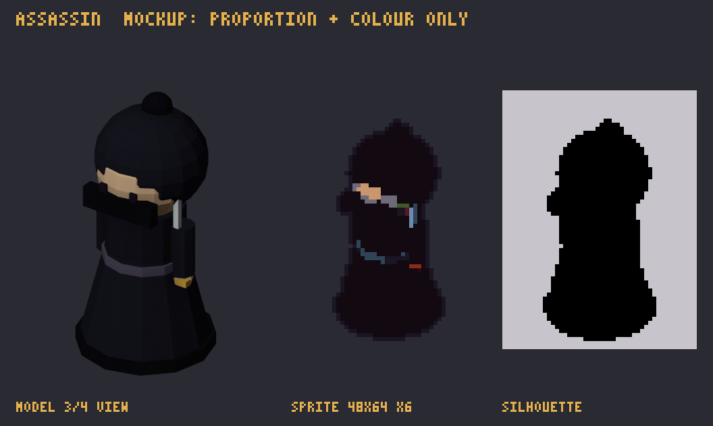

# มือสังหารเงา · `assassin`

> ชุดงาน 2 · ศัตรูพื้น · การ์ดนี้สร้างจาก `docs/data` ด้วย `npm run art:brief` (อย่าแก้มือ) · สเปกรวมและวิธีส่งงาน: [art-bible](../art-bible.md)

_mockup นี้บอกแค่ **สัดส่วนและสี** ไม่ใช่สไตล์สุดท้าย ศิลปินออกแบบรายละเอียดเองตาม art-bible_

| หัวข้อ | รายละเอียด |
|---|---|
| ธาตุ | โลหะ 金 |
| ชื่อ (EN) | Shadow Assassin |
| ลักษณะในเกม | ล่องหน — ต้องมีหอกระจกไท่จี๋ หรือไม้ตายสิงห์คำราม |
| palette | **shared:** `#1A1423` `#F2C9A0` `#C9966E` `#E3B04B` `#D2412F` `#EEF3F8` **enemy:** `#8A2A1A` `#5A1820` `#2A0A10` `#3E5A2A` `#6E6A78` `#120A10` **metal:** `#E5EAF0` `#D9E1EA` `#9FB3CA` `#6B8AAD` `#486483` `#304357` |
| ขนาดเฟรม | 48×64 |
| ท่า | walk 6 · hit 2 · death 6 @ 10 fps |
| ไฟล์ส่ง | `assassin.aseprite` + `assassin_walk.png`, `assassin_hit.png`, `assassin_death.png` |

## การอ่านภาพในเกม

ล่องหน: ต้องอ่านออกทั้งสองสถานะ ปกติ = โครงดำทึบเห็นแค่ตาและใบมีด, ล่องหน = เหลือแค่เส้นขอบ 1px (เอนจินทำความโปร่งและกระพริบเอง ศิลปินวาดพิกเซลทึบ), ถูกเปิดเผย = ขอบขาวดำ (หอไท่จี๋)
