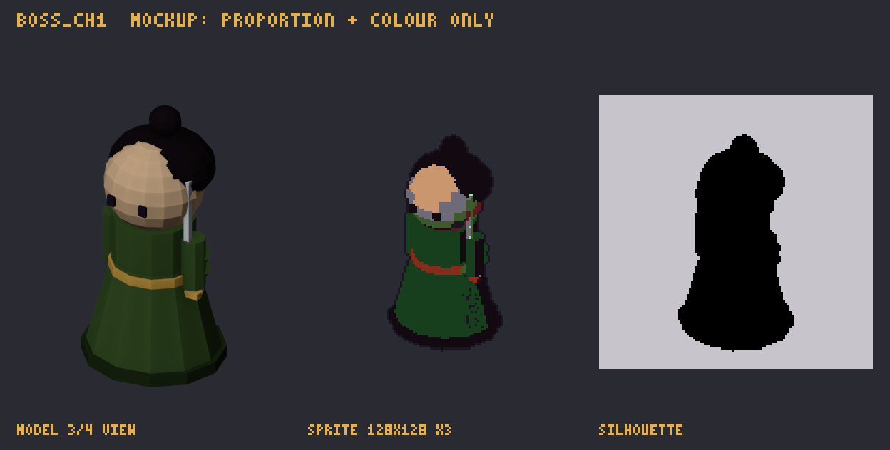

# ราชาโจรร้อยมือ · `boss_ch1`

> ชุดงาน 2 · บอส บท 1 wave 10 · การ์ดนี้สร้างจาก `docs/data` ด้วย `npm run art:brief` (อย่าแก้มือ) · สเปกรวมและวิธีส่งงาน: [art-bible](../art-bible.md)

_mockup นี้บอกแค่ **สัดส่วนและสี** ไม่ใช่สไตล์สุดท้าย ศิลปินออกแบบรายละเอียดเองตาม art-bible_

| หัวข้อ | รายละเอียด |
|---|---|
| ธาตุ | ไม้ 木 |
| ชื่อ (EN) | Hundred-Hand Bandit King |
| กลไก | throws hidden weapons that disable a random disciple for 3s at 75/50/25% HP |
| palette | **shared:** `#1A1423` `#F2C9A0` `#C9966E` `#E3B04B` `#D2412F` `#EEF3F8` **enemy:** `#8A2A1A` `#5A1820` `#2A0A10` `#3E5A2A` `#6E6A78` `#120A10` **wood:** `#9FDCA7` `#5BC46A` `#3DA94C` `#2F833B` `#225F2B` `#173F1D` |
| ขนาดเฟรม | 128×128 |
| ท่า | idle 6 · attack 8 · phaseChange 12 · death 12 @ 12 fps |
| ไฟล์ส่ง | `boss_ch1.aseprite` + `boss_ch1_idle.png`, `boss_ch1_attack.png`, `boss_ch1_phaseChange.png`, `boss_ch1_death.png` |

## การอ่านภาพในเกม

ราชาโจร ตัวใหญ่ หลายแขนถืออาวุธลับ เฟส 75/50/25% ขว้างอาวุธ: ท่าง้างแขนทั้งหมดพร้อมกัน
