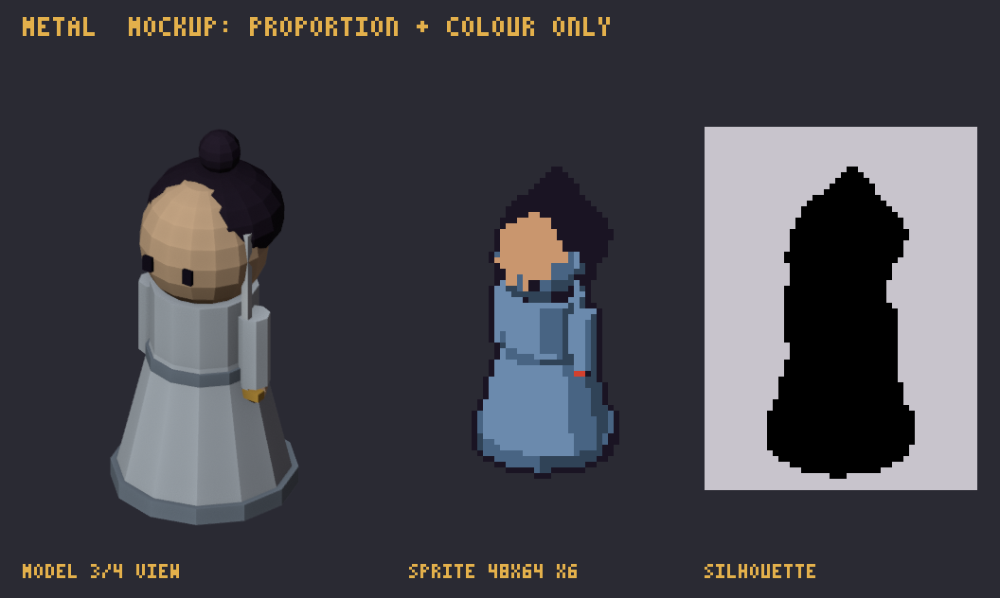

# ศิษย์สำนักกระบี่เมฆา · `metal`

> ชุดงาน 1 · ตัวละคร · การ์ดนี้สร้างจาก `docs/data` ด้วย `npm run art:brief` (อย่าแก้มือ) · สเปกรวมและวิธีส่งงาน: [art-bible](../art-bible.md)

_mockup นี้บอกแค่ **สัดส่วนและสี** ไม่ใช่สไตล์สุดท้าย ศิลปินออกแบบรายละเอียดเองตาม art-bible_

| หัวข้อ | รายละเอียด |
|---|---|
| ธาตุ | โลหะ 金 |
| ชื่อ (EN) | Cloud Sword Pavilion |
| บทบาท | single-target DPS, crit |
| silhouette | tall, sword raised |
| อาวุธ | jian (straight sword) |
| สีหลัก | `#D9E1EA` |
| palette | **shared:** `#1A1423` `#F2C9A0` `#C9966E` `#E3B04B` `#D2412F` `#EEF3F8` **metal:** `#E5EAF0` `#D9E1EA` `#9FB3CA` `#6B8AAD` `#486483` `#304357` |
| ขนาดเฟรม | 48×64 (pivot ที่เท้า, หันขวา) |
| ท่า | idle 4 · attack 6 · skill 8 · levelUp 6 @ 10 fps |
| ขั้นเลเวล (ของประดับเพิ่ม ไม่เปลี่ยนโครง) | Lv1 ปราณกระบี่: ranged crescent slash Lv2 พันกระบี่ร่วง: every 6th hit rains 5 swords, crit x2 Lv3 กระบี่ในใจ: crits pierce through all enemies in a line |
| ไฟล์ส่ง | `metal.aseprite` + `metal_idle.png`, `metal_attack.png`, `metal_skill.png`, `metal_levelUp.png` |

## การอ่านภาพในเกม

สูงโปร่ง กระบี่ชูเหนือหัวเห็นชัดทุกเฟรม (เส้นตั้งยาวคือจุดจำ) ชุดขาวเงินห้ามจมกับพื้นหิมะ ใช้เงาฟ้าเทาแยก
