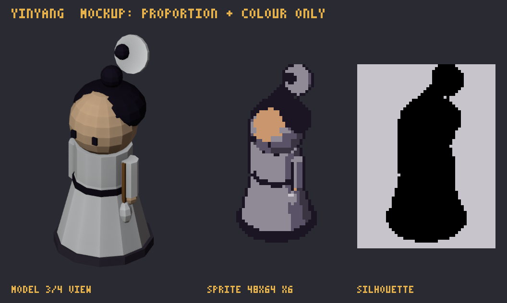

# ศิษย์หอกระจกไท่จี๋ · `yinyang`

> ชุดงาน 1 · ตัวละคร · การ์ดนี้สร้างจาก `docs/data` ด้วย `npm run art:brief` (อย่าแก้มือ) · สเปกรวมและวิธีส่งงาน: [art-bible](../art-bible.md)

_mockup นี้บอกแค่ **สัดส่วนและสี** ไม่ใช่สไตล์สุดท้าย ศิลปินออกแบบรายละเอียดเองตาม art-bible_

| หัวข้อ | รายละเอียด |
|---|---|
| ธาตุ | หยินหยาง ☯ |
| ชื่อ (EN) | Taiji Mirror Hall |
| บทบาท | support: buffs, economy, reveal |
| silhouette | seated meditation, floating taiji |
| อาวุธ | whisk + talismans |
| สีหลัก | `#F2F2F2` |
| palette | **shared:** `#1A1423` `#F2C9A0` `#C9966E` `#E3B04B` `#D2412F` `#EEF3F8` **yinyang:** `#F2F2F2` `#C8C4CC` `#8F8A96` `#5A5266` `#3A3442` `#FFFFFF` |
| ขนาดเฟรม | 48×64 (pivot ที่เท้า, หันขวา) |
| ท่า | idle 4 · attack 6 · skill 8 · levelUp 6 @ 10 fps |
| ขั้นเลเวล (ของประดับเพิ่ม ไม่เปลี่ยนโครง) | Lv1 ญาณกระจก: reveals stealth (shadow assassins) in r=3 Lv2 สมดุลปราณ: adjacent disciples +20% rate Lv3 ยันต์โชคลาภ: +1 silver per kill in r=3, +1% interest |
| ไฟล์ส่ง | `yinyang.aseprite` + `yinyang_idle.png`, `yinyang_attack.png`, `yinyang_skill.png`, `yinyang_levelUp.png` |

## การอ่านภาพในเกม

นั่งสมาธิลอยเหนือพื้นเล็กน้อย มีไท่จี๋หมุนลอยเหนือหัว ขาวดำตัดกันแรง ถือแส้ปัดฝุ่น
