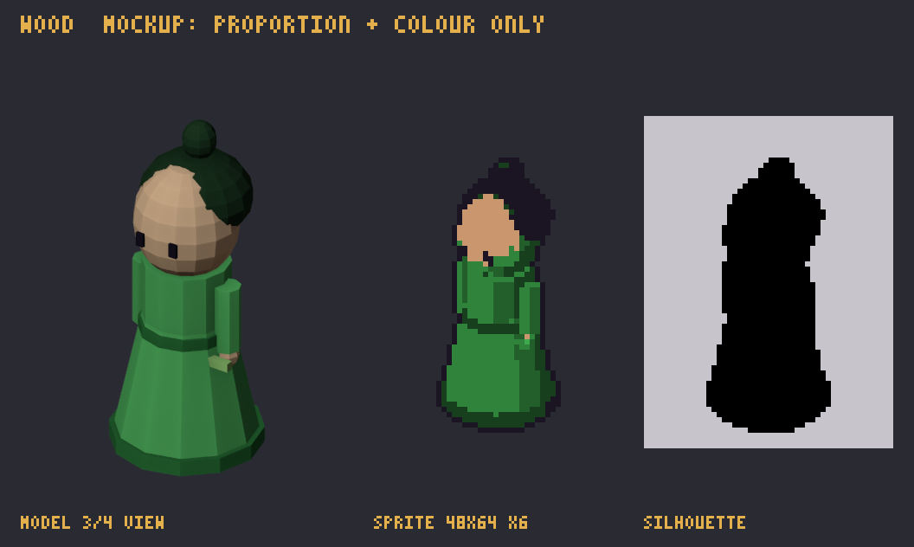
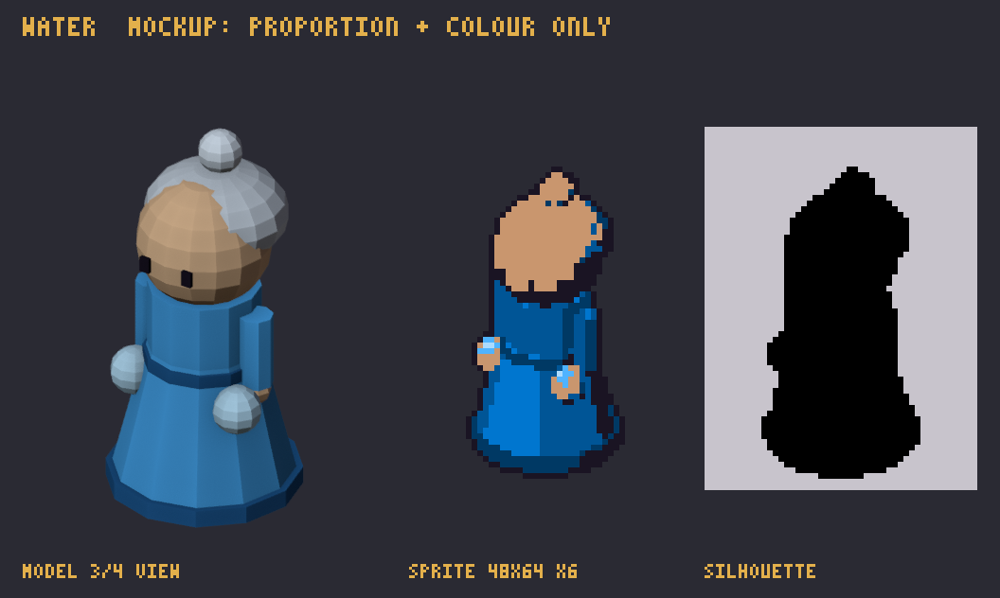
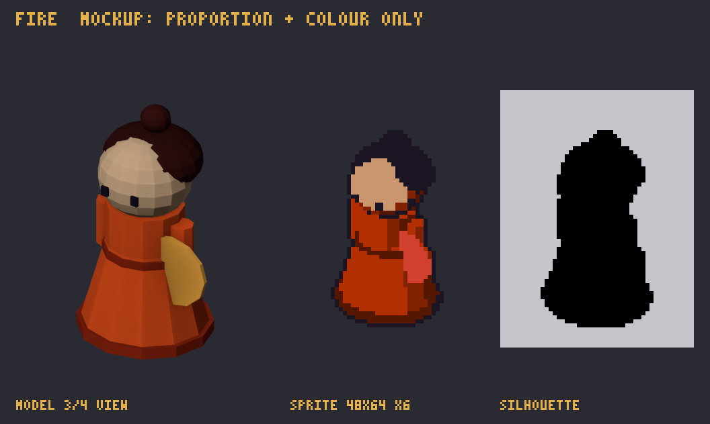
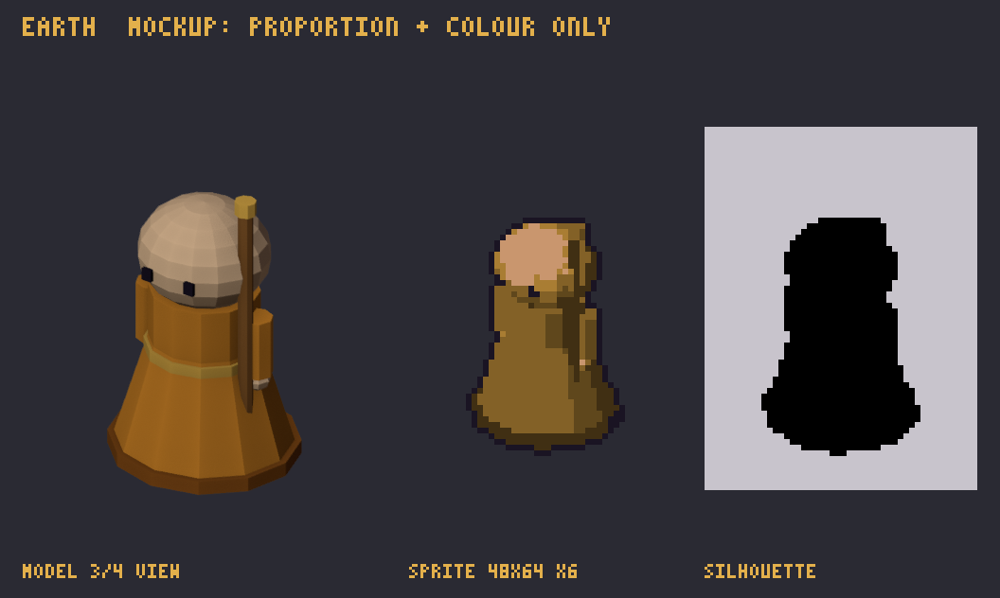

# Character Design: ศิษย์ห้าสำนัก + หอไท่จี๋

> **Character Design Document.** The six sect disciples players place on the board, their level tiers, and the later forms (combos, grandmasters, gacha heroes). Spec, palette and delivery rules: [art-bible](art-bible.md). Numbers and names come from `docs/data/sects.json` and `heroes.json`.

**กฎร่วมทุกตัว**
- chibi 2.5 หัว ขนาด 48×64 หันขวา
- แต่ละสำนักต้องแยกกันได้จาก silhouette อย่างเดียว ดูจากอาวุธและท่ายืน
- เลเวลไม่เปลี่ยนโครงตัว เพิ่มแค่ของประดับ (ผู้เล่นต้องจำตัวเดิมได้)
  - **Lv1 ศิษย์:** ชุดเรียบ
  - **Lv2 ศิษย์เอก:** ผ้าคาดเอว/ผ้าคลุมไหล่สีเข้มขึ้น อาวุธมีลวดลาย
  - **Lv3 ผู้อาวุโส:** เครื่องประดับทอง `#E3B04B` + ออร่าจางในเอนจิน (ไม่วาดออร่าใน sprite)
- ท่า:
  - `idle` 4 · `attack` 6 · `skill` 8 · `levelUp` 6 (10 fps)
  - `attack` ต้องบอกเลขเฟรมที่ปล่อยกระสุน
  - `skill` คือสกิล Lv2/Lv3 ของสำนักนั้น

| สำนัก | การ์ด | mockup |
|---|---|---|
| สำนักกระบี่เมฆา (โลหะ) | [metal](assets/metal.md) |  |
| หุบไผ่หยก (ไม้) | [wood](assets/wood.md) |  |
| วังธาราเหมันต์ (น้ำ) | [water](assets/water.md) |  |
| สำนักหงส์เพลิง (ไฟ) | [fire](assets/fire.md) |  |
| วัดวัชระศิลา (ดิน) | [earth](assets/earth.md) |  |
| หอกระจกไท่จี๋ (หยินหยาง) | [yinyang](assets/yinyang.md) |  |

## สำนักกระบี่เมฆา 金 (`metal`)
- **นิสัย:** เย็นชา มั่นใจ ฝึกจนกระบี่เป็นส่วนหนึ่งของกาย
- **silhouette:** สูงโปร่งที่สุดในหกสำนัก กระบี่ตรง (เจี้ยน) ชูขึ้น เส้นตั้งยาวคือจุดจำ
- **สี:** ขาวเงิน `#D9E1EA` เงาฟ้าเทา ผมดำ ด้ามกระบี่ทอง
- **ท่า:** attack ฟันเป็นเสี้ยวจันทร์ส่งปราณกระบี่ · skill "พันกระบี่ร่วง" ชี้กระบี่ขึ้นฟ้า
- **Lv:** Lv2 ผ้าคลุมไหล่ฟ้าเทา · Lv3 ปิ่นทอง + พู่กระบี่แดง

## หุบไผ่หยก 木 (`wood`)
- **นิสัย:** เงียบ ลึกลับ หมอยาและนักพิษ
- **silhouette:** ผอม ตัวเอียงเล็กน้อย ขลุ่ยขวางลำตัว (เส้นนอน) ผมยาวบังหน้าครึ่งหนึ่ง
- **สี:** เขียวหยก `#5BC46A` เงาเขียวเข้ม ขลุ่ยไผ่เขียวอ่อน
- **ท่า:** attack เป่าขลุ่ยแล้วเข็มพิษพุ่ง · skill "เถาวัลย์รัด" ตบพื้นแล้วเถาขึ้น
- **Lv:** Lv2 หมวกไผ่สาน · Lv3 ใบไผ่ทองที่ผ้าคาด

## วังธาราเหมันต์ 水 (`water`)
- **นิสัย:** สง่า สงบ ใจเย็นเหมือนน้ำแข็ง
- **silhouette:** ชุดพลิ้วยาวลากพื้น แพรไหมลอยรอบตัว ฝ่ามือยื่นไปข้างหน้า
- **สี:** ฟ้าน้ำแข็ง `#4FB3FF` ผมขาวฟ้า แพรไหมฟ้าอ่อน
- **ท่า:** attack ผลักฝ่ามือส่งคลื่นวง · skill "บัวน้ำแข็ง" พนมมือแล้วบัวน้ำแข็งบาน
- **Lv:** Lv2 มงกุฎเกล็ดน้ำแข็ง · Lv3 แพรไหมเพิ่มเป็นสองเส้น ปลายทอง

## สำนักหงส์เพลิง 火 (`fire`)
- **นิสัย:** ร้อนแรง ชอบโชว์ เสียงดัง
- **silhouette:** ยืนกว้างที่สุด พัดกางครึ่งวงกลม ผมมัดสูงเหมือนหางหงส์
- **สี:** แดงส้ม `#FF5A1F` พัดส้มทอง ผมแดงเข้ม
- **ท่า:** attack สะบัดพัดเป็นกรวยเปลวไฟ · skill "ขนหงส์กระจาย" หมุนตัวโปรยขนไฟ
- **Lv:** Lv2 ปิ่นขนหงส์ · Lv3 พัดทองลายหงส์

## วัดวัชระศิลา 土 (`earth`)
- **นิสัย:** ใจดี หนักแน่น ยึดหลัก ปกป้องคนอื่น
- **silhouette:** ไหล่กว้าง หัวโล้น พระถือพลองยาวกว่าตัว ตัวเตี้ยหนักที่สุด
- **สี:** จีวรทองดิน `#C99A4A` ผิวเข้มกว่าสำนักอื่นเล็กน้อย พลองไม้น้ำตาลหัวทอง
- **ท่า:** attack กระแทกพลองลงพื้น (คลื่นกระแทก) · skill "ระฆังทอง" ระฆังทองครอบตัว (วางบนทางเดินได้)
- **Lv:** Lv2 ลูกประคำใหญ่คล้องคอ · Lv3 จุดทองที่หน้าผาก + ปลายพลองทองสองข้าง

## หอกระจกไท่จี๋ ☯ (`yinyang`)
- **นิสัย:** นักพรตอารมณ์ขัน รู้ทุกอย่าง สายสนับสนุน
- **silhouette:** นั่งสมาธิลอยเหนือพื้น ไท่จี๋หมุนลอยเหนือหัว ถือแส้ปัดฝุ่น
- **สี:** ขาว `#F2F2F2` + ดำ `#3A3442` ตัดกันแรง ยันต์กระดาษเหลือง
- **ท่า:**
  - idle ลอยขึ้นลงช้าๆ ไท่จี๋หมุน
  - attack ปาเยันต์
  - skill "สมดุลปราณ" กางแขน วงไท่จี๋ขยายบนพื้น
- **Lv:** Lv2 หมวกนักพรต · Lv3 ไท่จี๋สองวงหมุนสวนกัน

## ร่างผสาน 10 แบบ (ชุดงาน 6)
- ศิษย์สองสำนักรวมกันเป็นตัวเดียว ใช้โครงของสำนักแรก เพิ่มสีและของประดับจากสำนักที่สอง
- ขนาดและท่าเท่าศิษย์ปกติ
- ตอนผสานมีเอฟเฟกต์พิเศษ ดู [vfx-design](vfx-design.md)
- การ์ด: [assets/README.md](assets/README.md) (id ขึ้นต้น `combo-`)

## ปรมาจารย์ 4 คน (ชุดงาน 6)
- เกิดจากสามสำนักรวมกัน มีได้ทีละคนต่อด่าน
- งานต่อคน:
  - sprite ขนาดบอส 128×128
  - ภาพ cut-in หมึกจีน 360×200 (โชว์ 0.8 วิตอนลงสนาม)
- การ์ด id ขึ้นต้น `gm-`

## วีรชน 24 คน (gacha, Season 1)
- 4 คนต่อสำนัก เป็น **sidegrade**: เก่งต่างแบบ ไม่แรงกว่า
- ภาพต้องไม่ทำให้ผู้เล่นรู้สึกว่าจ่ายเงินแล้วได้พลัง
  - ห้ามตัวใหญ่กว่าศิษย์ปกติ
  - ห้ามออร่าเยอะกว่า Lv3 ปกติ
- ทำได้: ชุดใหม่ อาวุธแบบต่าง ท่าสกิลใหม่ + portrait 64×64
- รายชื่อจาก `docs/data/heroes.json` การ์ด id `hero_1` ถึง `hero_24` ใน [assets/README.md](assets/README.md)
