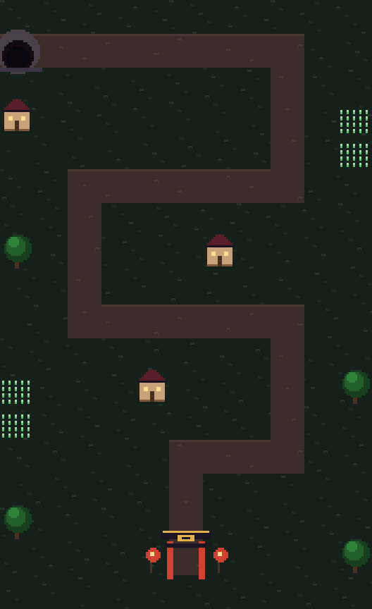
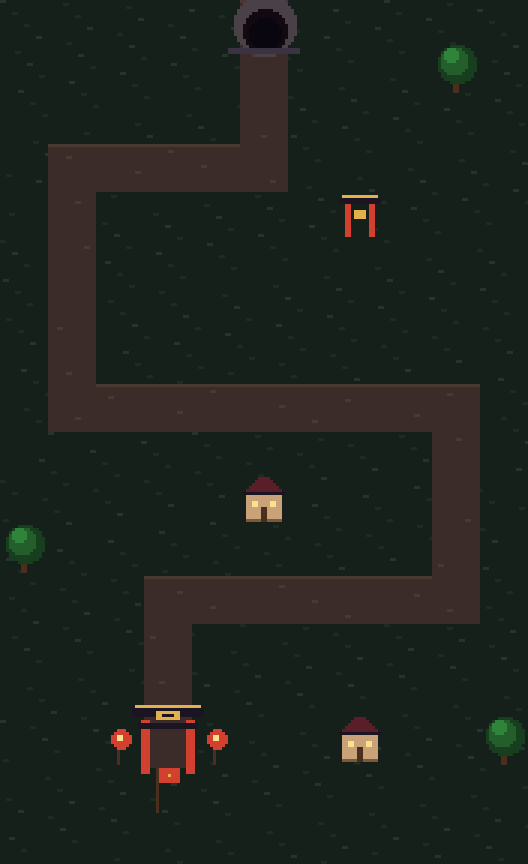
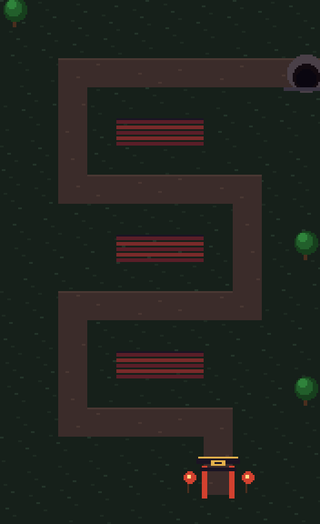
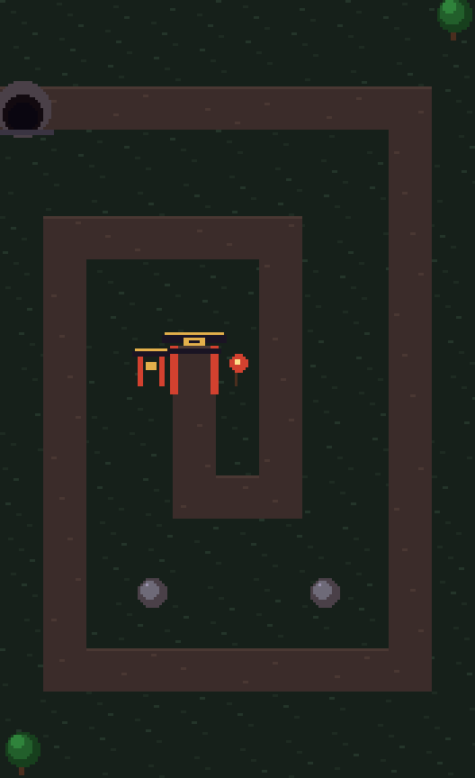
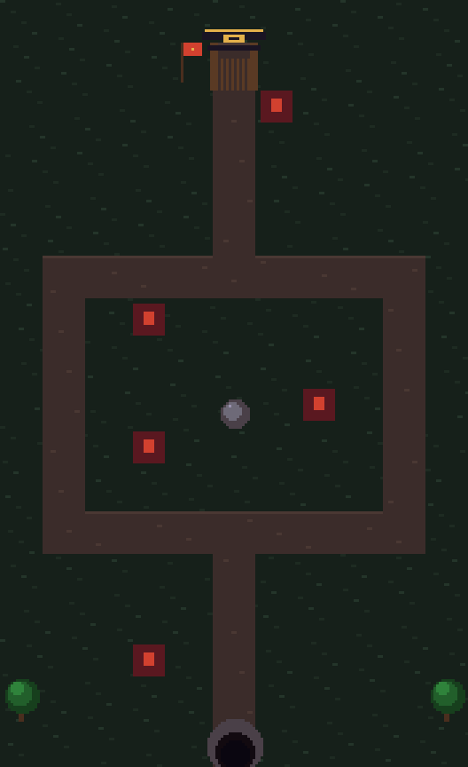
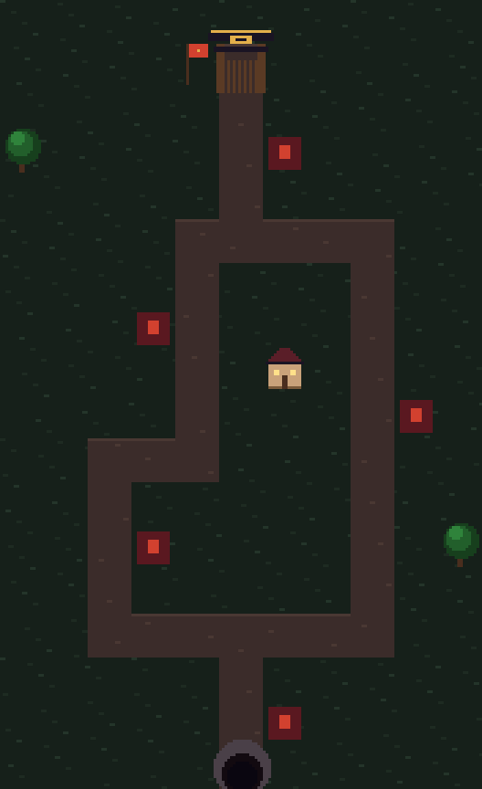
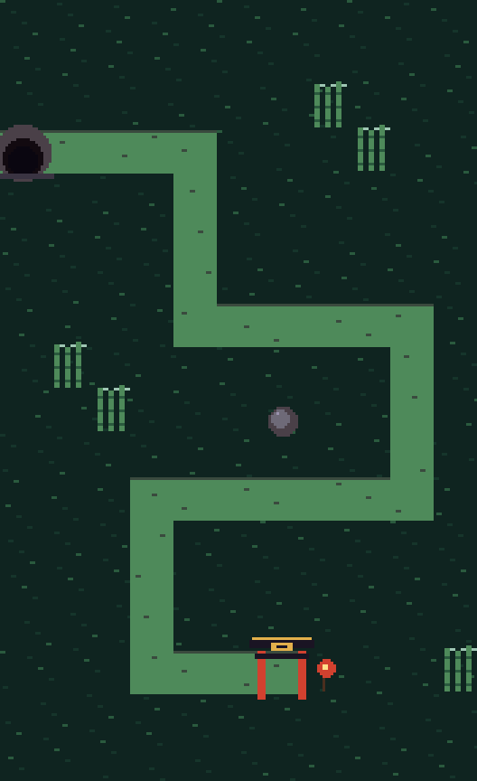
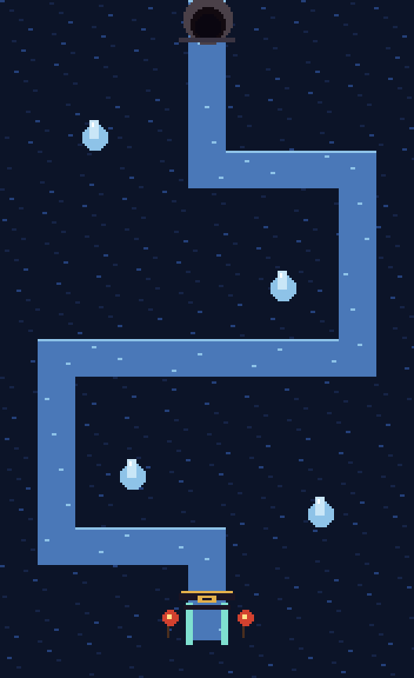
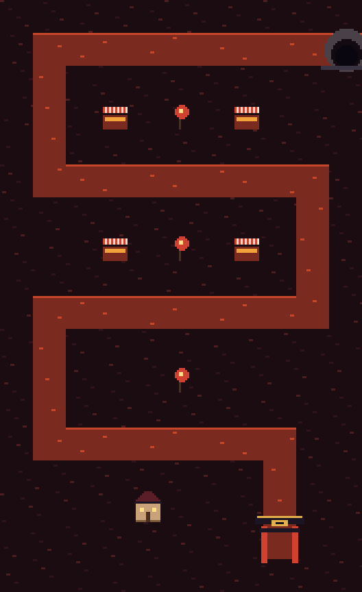
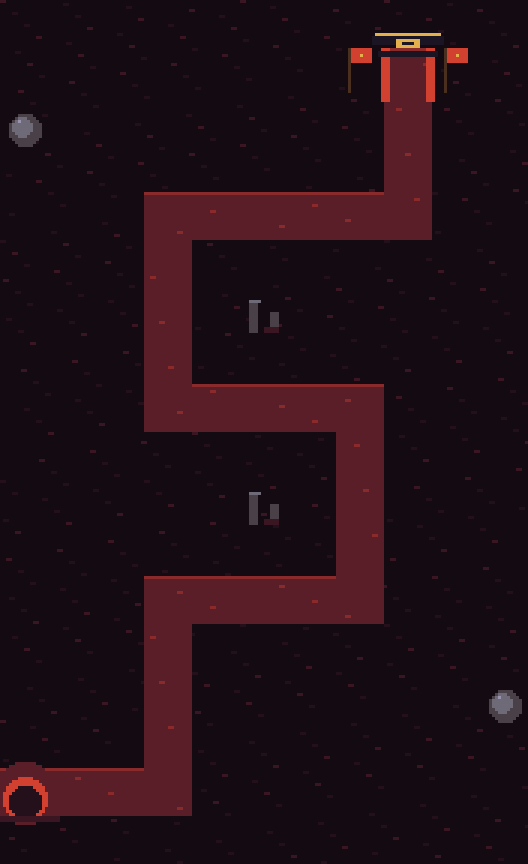

# Map Design Document: แผนที่ ศึกห้าสำนัก

> **EN summary for artists:** Portrait 11×18-tile boards. Enemies enter from a spawn gate on the board edge and walk to the sect's goal gate *inside* the board. Five biomes, each with its own palette, props and one rule that changes play. Layout data lives in `docs/data/maps.json`; this doc explains it and lists the art needed. Mockups: `docs/art/mockups/map-*.png`. They show layout, colour and placement only, not the final art style.
>
> ส่วนหนึ่งของ [Art Bible](art-bible.md) · ระบบด่านและจำนวนผัง: [design/maps.md](../design/maps.md) · ข้อมูล: [`data/maps.json`](../data/maps.json)

## 1. กติกาของทุกแผนที่
| กติกา | เหตุผล |
|---|---|
| กระดาน 11×18 ช่อง จอแนวตั้ง (ดูข้อ 7) | เล่นมือเดียวบนมือถือ, ใช้ผังเดียวกันทั้งเว็บและแอป |
| ศัตรู**เกิดที่ประตูเกิดบนขอบกระดาน** (ถ้ำ ช่องเขา ประตูมิติ) | ผู้เล่นเห็นว่ามาจากไหน ไม่โผล่กลางอากาศ |
| ศัตรู**จบที่ประตูสำนักภายในกระดาน** (แถว ≤ 16, ไม่อยู่บนขอบ) | แก้ปัญหา "เดินออกนอกแผนที่" ผู้เล่นเห็นสิ่งที่ต้องปกป้อง |
| ประตูสำนักกะพริบแดงเมื่อศัตรูหลุดเข้าไป | บอกว่าเสียชีวิตตรงไหน |
| ของประกอบบางชนิด**ขวางการวาง** (บ้าน ต้นไม้ หิน ไผ่ น้ำแข็ง แผงตลาด ซากวิหาร) | สร้างทางเลือก ช่องดีมีจำกัด ไม่วางที่ไหนก็ได้ |
| ของประกอบบางชนิด**วางทับได้** (หลังคา นาข้าว โคม ธง) | ตกแต่งโดยไม่ลดช่องวาง หลังคาคือกลไกบท 1 |
| ช่องที่วางศิษย์ได้มี**กรอบมุมเรืองแสง** และกะพริบเมื่อมีเงินพอ | ตอบปัญหา "ไม่รู้ว่าต้องวางตรงไหน" |
| Variant `mirror` กลับซ้าย–ขวาให้อัตโนมัติ | ผังเดียวได้สองแผนที่ ต้นทุนเกือบศูนย์ |

ทุกกติกาตรวจอัตโนมัติด้วย test ใน `packages/sim/test/sim.test.ts` (describe `maps`)

## 2. ภูมิภาค (Biome)

| ภูมิภาค | บท | เวลา/อารมณ์ | Palette | ประตูเกิด → ประตูสำนัก | ของประกอบเด่น | กลไก | จุดว้าว (ภาพที่คนจะแคปไปแชร์) |
|---|---|---|---|---|---|---|---|
| หมู่บ้านเชิงเขา | 1 | พลบค่ำสีส้มม่วง ควันหุงข้าว นาขั้นบันไดสะท้อนโคม | `env` | ช่องเขา → ประตูสำนัก (ไพฟางแดง) | บ้านไม้, หลังคา, นาข้าว, ศาลเจ้า, โคม | หลังคา: ศัตรูกระโดดข้าม วางศิษย์บนหลังคาได้ | ฝูงโจรถือคบไฟวิ่งผ่านนาขั้นบันไดยามพลบ |
| หุบไผ่ในหมอก | 2 | รุ่งสาง หมอกเขียวอมฟ้า แสงลอดลำไผ่ | `env-bamboo` | หุบหมอก → ประตูสำนัก | กอไผ่, ลำธาร, ก้อนหิน, สะพานไม้ | หมอก: เห็นศัตรูเฉพาะในระยะ ศิษย์หุบไผ่มองทะลุ | หมอกแหวกเป็นช่องตอนศิษย์ไม้ยิง |
| วังน้ำแข็งเหนือ | 3 | กลางคืน แสงเหนือ ทะเลสาบน้ำแข็งสีคราม | `env-ice` | สะพานน้ำแข็ง → ประตูหยก | ก้อนน้ำแข็ง, ต้นสนหิมะ, วังหยก | น้ำแข็งลื่น: ศัตรูไถลเร็ว ไฟละลายเป็นหลุม | ไฟละลายทางเป็นหลุม ศัตรูตกน้ำ |
| เมืองเพลิงใต้ | 4 | ตลาดกลางคืน โคมแดง ควันธูป | `env-fire` | ประตูคลอง → ประตูเมือง | แผงตลาด, โคมแดง, คลอง, เรือ | หลายเส้นทาง: ประตูเมืองเปิด/ปิดระหว่าง wave | ประทัดระเบิดตอนประตูเมืองสลับทาง |
| ยอดเขาจันทร์โลหิต | 5 | จันทร์แดงเต็มฟ้า หน้าผาบันไดหิน | `env-bloodmoon` | ประตูมิติมาร → ศาลสุดท้าย | ซากวิหาร, ธงขาด, หิน | จันทร์โลหิต: ทุก 5 wave ธาตุศัตรูเปลี่ยนตามเฟสจันทร์ | จันทร์เปลี่ยนสี ทั้งฉากเปลี่ยนโทนตาม |

กติกาสีฉาก: โทนจางและเข้มกว่าตัวละคร 1–2 ขั้น ให้ศิษย์และศัตรูเด่นเสมอ (GDD §3)

## 3. ผังแผนที่ (Layouts)

| ผัง | ภูมิภาค | ชนิด | ใช้ในด่าน | ภาพ |
|---|---|---|---|---|
| `village-terraces` นาขั้นบันได | หมู่บ้าน | ตั้งรับ | T-1, 1-1, 1-2 (mirror) |  |
| `village-shrine` ลานศาลเจ้า | หมู่บ้าน | ตั้งรับ | 1-4, 1-7 (mirror) |  |
| `village-rooftops` หลังคาหมู่บ้าน | หมู่บ้าน | ตั้งรับ (ศัตรูบิน) | 1-6 |  |
| `village-spiral` วงล้อมวิหาร | หมู่บ้าน | สนามบอส | 1-10, 1-12 |  |
| `village-camp` ค่ายโจรเชิงเขา | หมู่บ้าน | บุกค่าย | 1-3, 1-11 (mirror) |  |
| `village-checkpoint` ด่านตรวจโจร | หมู่บ้าน | บุกค่าย | 1-8 |  |
| `bamboo-stream` ลำธารไผ่ | หุบไผ่ | ตั้งรับ (ตัวอย่างธีม) | — |  |
| `ice-lake` ทะเลสาบน้ำแข็ง | น้ำแข็ง | ตั้งรับ (ตัวอย่างธีม) | — |  |
| `fire-market` ตลาดโคมแดง | เมืองเพลิง | ตั้งรับ (ตัวอย่างธีม) | — |  |
| `bloodmoon-stairs` บันไดหินจันทร์แดง | จันทร์โลหิต | ตั้งรับ (ตัวอย่างธีม) | — |  |

ผังของบท 2–5 ตอนนี้มีบทละ 1 ผังเพื่อโชว์ธีม ผังจริงบทละ 6 จะออกแบบตาม [design/maps.md](../design/maps.md)

**หลักออกแบบผัง**
- เส้นทางยาว 31–57 ช่อง: ด่านต้นสั้น ด่านบอสยาว (วงล้อม)
- ทุกผังมี "จุดคุ้ม" 2–3 จุดที่ยิงถึงทางหลายช่วง แต่บางจุดถูกบ้านหรือต้นไม้กันไว้ ผู้เล่นต้องเลือก
- ทางโค้งหักมุมทุก 3–8 ช่อง ไม่มีทางตรงยาวเกินครึ่งกระดาน (ศัตรูวิ่งเร็วผ่านง่ายเกินไป)
- ผังบุกค่ายต้องมีทางแยกซ้าย/ขวาที่ต่างกันชัดเจน (ป้อมน้อยแต่ยาว กับ ป้อมแข็งแต่สั้น)

## 4. แผนที่ "ตายตัว" ไหม
- **ด่านเนื้อเรื่องและ PvP ranked: ออกแบบมือ** เพราะต้องจูนสมดุล โดยเฉพาะ esports ที่ต้องแฟร์และเรียนรู้ได้ ความหลากหลายมาจาก
  - variant (mirror, เวลา, สภาพอากาศ)
  - ชุดศัตรู
  - ประเภทด่าน
  - กลไกภูมิภาค
- **หอคอยพันชั้น (Season 1): สุ่มจาก seed** ต่อชิ้นส่วนผังเป็น chunk ตาม design/maps.md
  - seed เดียวกันได้แผนที่เดียวกันทุกเครื่อง ใช้กับรีเพลย์และ leaderboard ได้
  - ตัวสร้างผังจะใช้กติกาข้อ 1 ทุกข้อ และใช้ test ชุดเดียวกันตรวจ
- **ลานสำนัก:** ผู้เล่นเลือกรูปเส้นทาง 3 แบบเอง และตกแต่งได้

## 5. งานภาพที่ต้องจ้าง (ต่อภูมิภาค)
สเปก v1: tile **32×32**, กระดาน 352×576 บนจอ 360×640 (ดู [Art Bible](art-bible.md))

| รายการ | จำนวน | หมายเหตุ |
|---|---|---|
| พื้นหลัก (หญ้า/หิมะ/หิน) | 4 แบบสุ่มสลับ | ต่อกันไร้รอยต่อ |
| ทางเดิน (autotile) | 16 ชิ้น (ตรง, โค้ง, แยก, ปลาย) | ขอบทางมีเงา 1px ด้านบน |
| ของประกอบ | 6–8 ชิ้น ตาม `propTypes` ของภูมิภาค | ยืนบนช่อง กว้างไม่เกิน 32 สูงไม่เกิน 48, pivot ที่ฐาน |
| ประตูเกิด | 1 (+ เฟรมเปิด 4 เฟรมตอนเริ่ม wave) | วางบนขอบ ครึ่งหนึ่งล้นออกนอกกระดานได้ |
| ประตูสำนัก/เป้าหมาย | 1 (+ เฟรมโดนตี 2 เฟรม) | 48×52, ต้องเด่นที่สุดในฉาก |
| ฉากหลังนอกกระดาน | 3 ชั้น parallax | เห็นตอนจอยาวกว่า 16:9 |
| เอฟเฟกต์ภูมิภาค | หมอก/หิมะตก/ประกายไฟ/จันทร์ | overlay โปร่งใส วนลูป |

ส่งมอบ: `.aseprite` + PNG sheet ตั้งชื่อ `<biome>_<item>.png` ตามกฎใน Art Bible

## 6. แก้ไขหรือเพิ่มผังอย่างไร
1. แก้ `docs/data/maps.json`: path ใช้พิกัดช่อง (x 0–10, y 0–17) เป็นเส้นตรงแนวตั้ง/นอนต่อกัน
2. `npm test`: ตรวจว่าทางเดินไม่ขาด, เริ่มบนขอบ, จบในกระดาน และของประกอบไม่ทับทาง
3. `python3 tools/art/map_mockups.py`: สร้างภาพ mockup ใหม่
4. ผูกกับด่านใน `docs/data/stages.json` (`layout`, `variant`) แล้วรัน `npm run sim:golden` และ `npm run unity:sync`

## 7. แนวตั้งหรือแนวนอน: เลือก**แนวตั้ง**
- **มือถือคือตลาดหลัก:** เกม TD/strategy แนวตั้งเล่นมือเดียวได้ เช่น บนรถไฟฟ้า (Rush Royale, Clash Royale, Arknights เป็นแนวนอน แต่ต้องใช้สองมือ)
- **PvP 1v1 บุก–ตั้งรับ:** แนวตั้งวางฝ่ายบุกด้านบน ฝ่ายรับด้านล่างได้เป็นธรรมชาติ แบบเดียวกับ Clash Royale ซึ่งเป็น esports มือถือที่สำเร็จ
- **คลิปสั้น** (TikTok/Reels) เป็นช่องทางหาผู้เล่นหลักใน GDD และวิดีโอแนวตั้งตัดลงคลิปได้ทันที
- **บนเว็บ/PC:** แสดงกระดานแนวตั้งกลางจอ ส่วนพื้นที่ซ้ายขวาใช้วางข้อมูล wave, แชท และ replay ไม่ต้องทำผังใหม่
- ข้อเสียคือมุมมองแคบกว่า แก้ด้วยกระดาน 11 ช่องกว้าง กับ sprite 48×64 ที่อ่านง่าย
