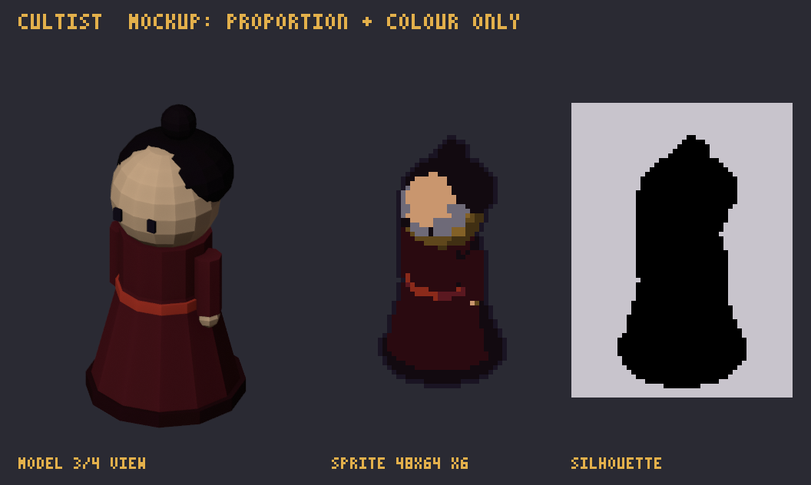
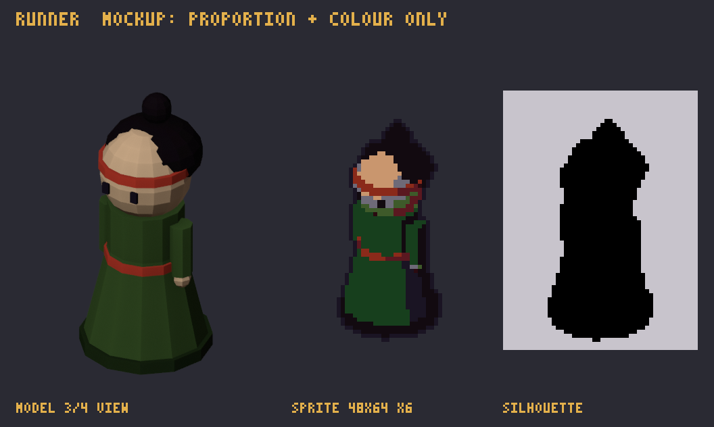
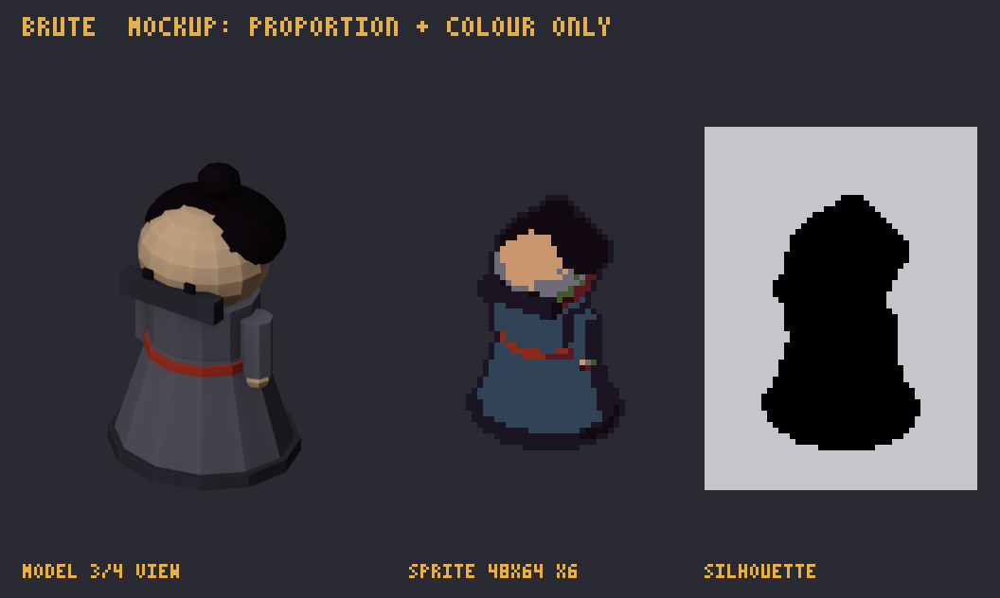
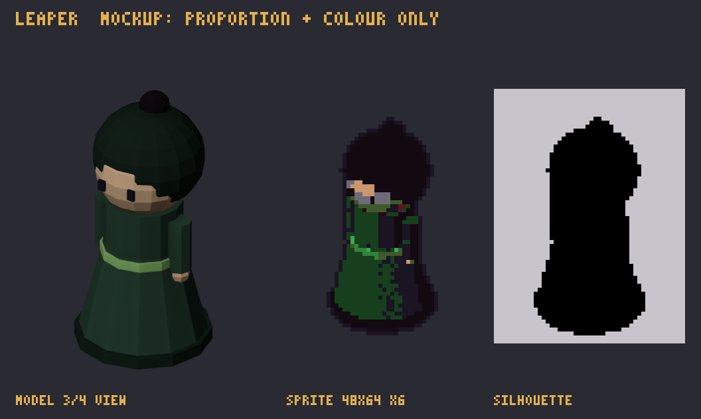
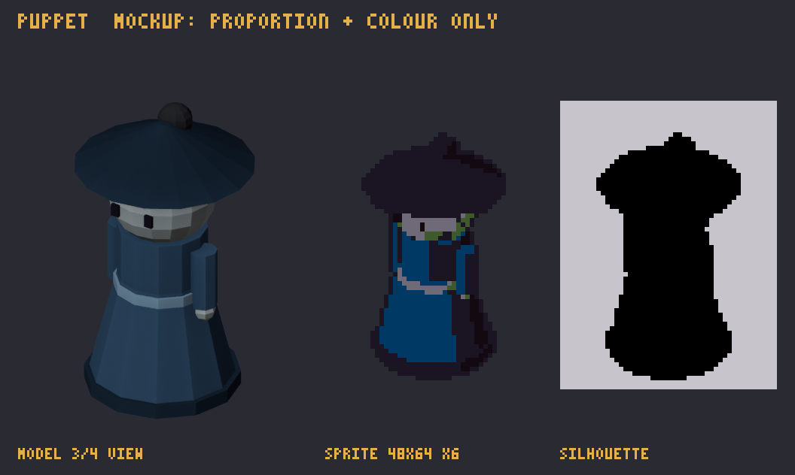
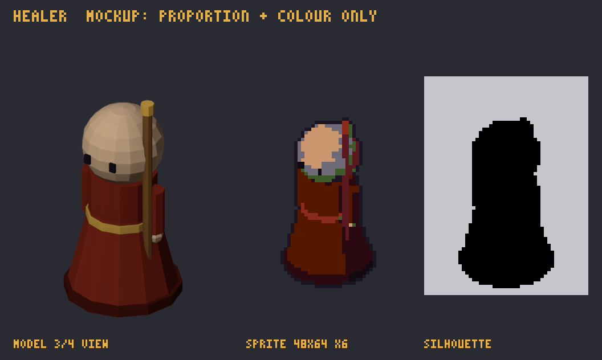
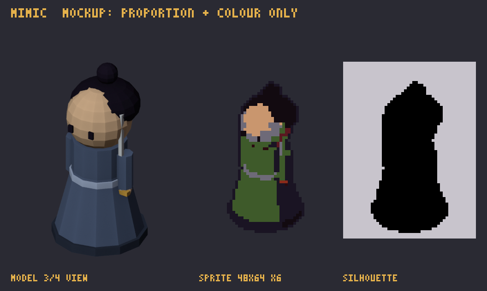
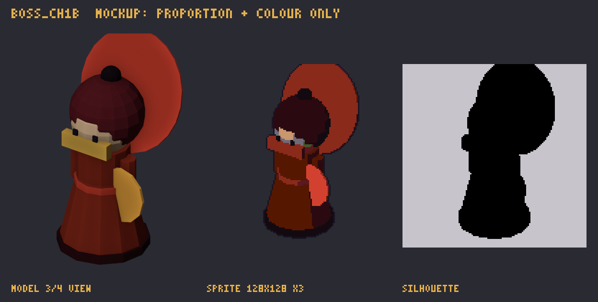
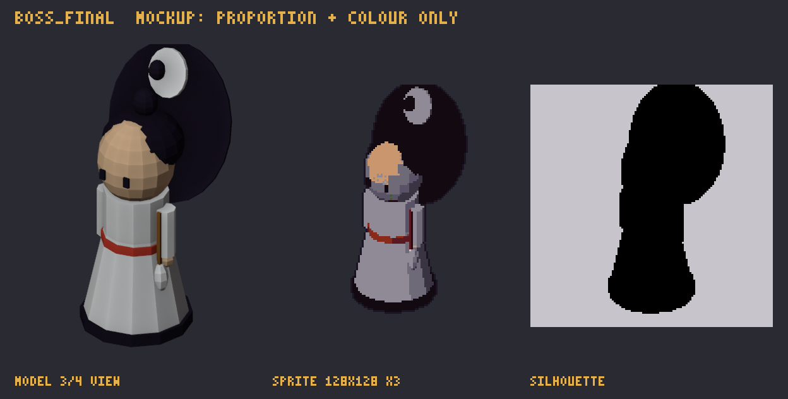

# Monster Design: พรรคมารจันทร์โลหิต

> **Monster Design Document.** Enemies, elite overlays and bosses. Each design starts from its gameplay role, then sets the visual rule the player must read in a split second on a phone. Spec and delivery: [art-bible](art-bible.md). Data: `docs/data/enemies.json`.

**กฎร่วม**
- ศัตรูเดินจากประตูเกิดไปประตูสำนัก หันขวา (เอนจินกลับด้านตามทิศเดิน) ขนาด 48×64
- โทนสีพรรคมาร: แดงเลือดหมู ดำม่วง เขียวหม่น ต้อง **ไม่ซ้ำสีประจำสำนัก** เพื่อแยกฝ่ายได้ทันที
- ทุกตัวมีผ้าคาดหรือเครื่องหมายแดงตราประทับ `#D2412F` ไว้บอกว่าเป็นพรรคมาร
- ธาตุของศัตรูบอกด้วยของประดับ 1 จุดสีธาตุ (เช่นพู่หรือตะเกียง) ไม่ทาทั้งตัว
- ท่า: `walk` 6 · `hit` 2 · `death` 6 (10 fps)
  - `death` จบด้วยกลายเป็นควัน/หมึกจาง ไม่มีเลือดสาด (เรตอายุทั่วไป)

## ศัตรู 8 ตัว

| id | ชื่อ | บทบาทในเกม → กฎการอ่านภาพ | การ์ด | mockup |
|---|---|---|---|---|
| `cultist` | สมุนพรรคมาร | ทหารพื้นฐาน → สัดส่วนกลาง ใช้เป็นฐานของศัตรูทุกตัว | [การ์ด](assets/cultist.md) |  |
| `runner` | โจรวิชาตัวเบา | พุ่ง 2 ช่องทุก 4 วิ → ตัวเล็ก ก้มไปข้างหน้า ผ้าคาดหัวปลิว มีเฟรมพุ่งยืดตัว | [การ์ด](assets/runner.md) |  |
| `brute` | ยักษ์เสื้อเหล็ก | เกราะลดดาเมจ → ใหญ่ 1.3 เท่า เกราะเทาเหล็กขอบสว่าง ท่าโดนตีมีประกายเกราะ | [การ์ด](assets/brute.md) |  |
| `leaper` | นักกระโดดหลังคา | ศัตรูบิน วัชระศิลาตีไม่ถึง → ตัวลอยสูงจากเงาบนพื้นชัดเจน walk คือกระโดด | [การ์ด](assets/leaper.md) |  |
| `puppet` | หุ่นศพ | ตายแล้วแตก 3 ตัว → ผิวซีด หมวกขุนนาง แขนยื่นตรง มีร่างเล็ก 32×40 แยกอีกชุด | [การ์ด](assets/puppet.md) |  |
| `assassin` | มือสังหารเงา | ล่องหน → ต้องมี 3 สถานะ: ปกติ, ล่องหน (เหลือขอบ), ถูกเปิดเผย (ขอบขาวดำ) | [การ์ด](assets/assassin.md) |  |
| `healer` | ภิกษุโลหิต | ฟื้นเลือดพวกข้างๆ → หัวโล้น จีวรแดงเข้ม ไม้เท้าทอง ท่าฟื้นเลือดยกไม้เท้า | [การ์ด](assets/healer.md) |  |
| `mimic` | ศิษย์ทรยศ | ทนธาตุที่โดนล่าสุด → ชุดคล้ายศิษย์สำนักแต่หม่น ขอบเปลี่ยนสีตามธาตุ (palette swap) | [การ์ด](assets/mimic.md) |  |

**ข้อควรระวัง**
- `assassin` ตอนล่องหนต้องยังเห็นได้เมื่อเพ่ง ผู้เล่นต้องรู้ว่ามีอยู่ แต่ยิงไม่ได้จนกว่าจะเปิดเผย
- `leaper` เงาบนพื้นคือข้อมูลเกม (ตำแหน่งจริง) ห้ามตัด
- `brute` ต้องใหญ่แต่ไม่บังศิษย์ที่ยืนข้างทาง สูงไม่เกิน 64 พิกเซล ใช้ความกว้างแทน

## ศัตรูชั้นยอด (overlay 3 แบบ)
- ไม่วาดศัตรูใหม่ ทำเป็นชั้นทับที่ใช้กับศัตรูได้ทุกตัว
- ชั้นทับคือขอบสี + ออร่าวน 4 เฟรม ขนาดเท่าศัตรู

| id | ชื่อ | สีขอบ | ภาพ |
|---|---|---|---|
| [`elite-golden`](assets/elite-golden.md) | เกราะทอง | `#E3B04B` | ประกายทองกระพริบที่ไหล่ |
| [`elite-swift`](assets/elite-swift.md) | ก้าวลม | `#9BE07A` | เส้นลมไหลหลังตัว |
| [`elite-undying`](assets/elite-undying.md) | ฟื้นคืน | `#D2412F` | ไฟวิญญาณแดงลอยรอบตัว |

## บอส 3 ตัว
- ขนาด 128×128
- ท่า: `idle` 6 · `attack` 8 · `phaseChange` 12 · `death` 12 (12 fps)
- บอสทุกตัวเปลี่ยนรูปตามเฟส ผู้เล่นต้องรู้จากภาพว่าเข้าเฟสใหม่แล้ว

| id | ชื่อ | กลไก → ภาพตามเฟส | การ์ด | mockup |
|---|---|---|---|---|
| `boss_ch1` | ราชาโจรร้อยมือ (บท 1 wave 10) | ขว้างอาวุธลับที่ 75/50/25% → แขนหลายคู่ แต่ละเฟสเหลืออาวุธในมือน้อยลง ท่าง้างแขนพร้อมกันก่อนขว้าง | [การ์ด](assets/boss_ch1.md) |  |
| `boss_ch1b` | ทูตจันทร์โลหิต (บท 1 wave 20) | ผนึกทีละสำนัก → จันทร์ด้านหลังเปลี่ยนเป็นสีธาตุที่ถูกผนึก หน้ากากทองร้าวทีละเฟส | [การ์ด](assets/boss_ch1b.md) |  |
| `boss_final` | จอมมารเสวี่ยเยว่ (บท 5 wave 30) | ดูดธาตุทีละเฟส → ไท่จี๋ด้านหลังและขอบชุดเปลี่ยนเป็นสีธาตุที่ดูดอยู่ เฟสสุดท้ายขาวดำล้วน | [การ์ด](assets/boss_final.md) |  |

- ภาพเปลี่ยนเฟส (`phaseChange`) ใช้ palette swap + ของประดับ ไม่ต้องวาดบอสใหม่ทั้งตัวทุกเฟส
- แบนเนอร์ชื่อบอสตอนปรากฏตัวอยู่ใน [ui-design](ui-design.md)
- ฟ้าจันทร์แดงอยู่ใน [vfx-design](vfx-design.md)
