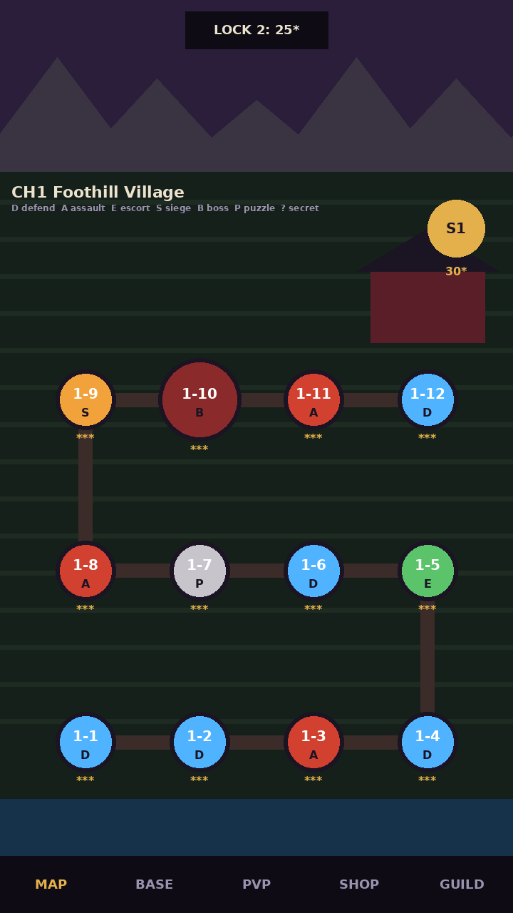
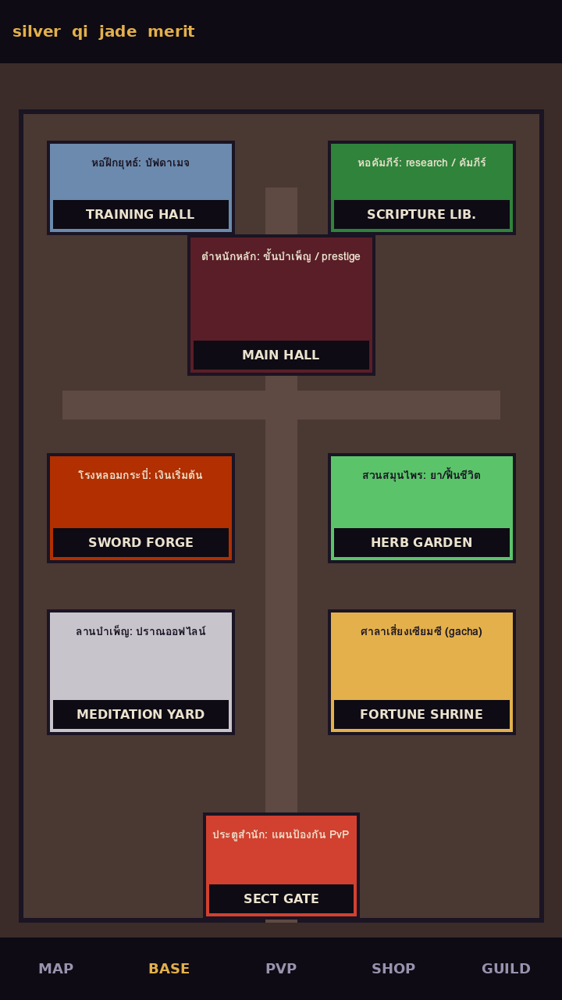

# World Map, Sect Base & Codex Design Document

> **EN summary for artists:** Three screens outside battle:
> - **World map:** a vertical scroll of chapters. Each chapter is a themed region with numbered stage nodes along a path and a boss landmark, plus star gates between chapters.
> - **Sect base:** the player's walled compound of upgradeable buildings (idle economy). Its gate leads to the PvP defence map.
> - **Codex:** illustrated "manual" pages with a stage map sketch, enemy notes and tips, unlocked by playing.
>
> All in portrait, pixel art, same palette rules as the battle maps. The mockups show layout only.
>
> ส่วนหนึ่งของ [Art Bible](art-bible.md) · แผนที่ในด่าน: [map-design](map-design.md) · UI: [ui-design](ui-design.md) · ระบบ: [GDD §5–6](../GDD.md)

ภาพอ้างอิงที่ผู้ใช้ส่งมา (เกมอื่น 5 ภาพ) ใช้เป็น**แนวคิด**เท่านั้น ห้ามลอกภาพหรือองค์ประกอบเฉพาะ ด้านล่างสรุปเป็นหลักการที่เราจะใช้

## 1. บทเรียนจากภาพอ้างอิง → สิ่งที่เราจะทำ
| ภาพอ้างอิง | ทำได้ดี | ใช้ในเกมเราอย่างไร |
|---|---|---|
| แผนที่โลกแบบเกาะลอย บทละเกาะ (3D) | 1 บท = 1 เกาะ ธีมชัด, เลขด่านเรียงบนทาง, บอสเป็นสิ่งก่อสร้างใหญ่ปลายทาง, ป้ายกุญแจบอกดาวที่ต้องใช้ | แผนที่โลก: บทละภูมิภาค, บอสเป็นแลนด์มาร์ก, ประตูดาวระหว่างบท |
| แผนที่ด่านแบบ node ต่อกัน (forest/ice/sand) | node แยกชนิดด่านได้ด้วยสีและไอคอน, มีจุดพักกลางทาง (กล่องรางวัล), ตัวละครบอสยืนบน node | node มีไอคอนตามชนิดด่าน (ตั้งรับ บุกค่าย คุ้มกัน ปิดล้อม บอส ปริศนา), ด่านลับแยกออกนอกเส้น, กล่องรางวัลดาวสะสม |
| ฐานบ้านแนวตั้ง pixel art มีป้ายชื่ออาคาร | เห็นทุกอาคารในจอเดียว ป้ายชื่อใหญ่อ่านง่าย ตัวละครเดินไปมาให้ฉากมีชีวิต ถนนเชื่อมอาคาร | ลานสำนัก: 6 อาคาร + ศาลาเซียมซี + ประตูสำนัก, ป้ายไทย, ศิษย์เดิน/ฝึกในลาน |
| หน้าคู่มือวาดมือ (แผนที่ + มอนสเตอร์ + เคล็ดลับ) | ข้อมูลก่อนเล่นเป็นของสะสมที่น่าอ่าน ไม่ใช่ป๊อปอัปน่าเบื่อ | **คัมภีร์ยุทธภพ:** หน้าแผนที่ + ศัตรู + เคล็ดลับ ปลดล็อกเมื่อพบศัตรู/ผ่านด่าน |
| TD pixel แนวตั้ง (ทางดินยกขอบ, วงประจุดวาง, ป่าล้อมขอบจอ, ประตูมิติจุดเกิด) | เห็นทันทีว่าวางตรงไหน, ทางเดินอ่านง่ายเพราะขอบนูน, ขอบจอเต็มไปด้วยต้นไม้ ไม่ว่าง | ใช้แล้วในเกม: **วงจุดบอกช่องวาง**, ขอบทางทุกด้าน, ประตูเกิด/ประตูสำนัก งานศิลป์จริงต้องมีหน้าผาดินข้างทาง + พุ่มไม้แน่นขอบกระดาน |

## 2. แผนที่โลก (เลือกด่าน)

- **โครง:** เลื่อนแนวตั้ง บทเก่าอยู่ล่าง บทใหม่อยู่บน ("ไต่ขึ้นสู่ยอดเขาจันทร์โลหิต" ตรงกับเรื่อง)
  - หนึ่งจอแสดงหนึ่งบท 12 ด่าน แล้วเลื่อนต่อไปบทถัดไป
- **node ด่าน:** วงกลม 36px (บอส 52px) สีตามชนิดด่าน ไอคอนตรงกลาง เลขด่านด้านบน ดาว 3 ดวงด้านล่าง
  - ด่านที่ยังไม่ปลดเป็นสีเทา มีกุญแจ
- **บอส:** สิ่งก่อสร้างประจำบทยืนเหนือ node บอส เช่น ป้อมโจรร้อยมือ (บท 1) หรือวังน้ำแข็ง (บท 3) เป็น "จุดว้าว" ของแต่ละบท
- **ด่านลับ:** node สีทองแยกออกนอกเส้นทาง แสดงดาวที่ต้องใช้ (S1 = 30 ดาว ตาม `stages.json > secretStages`)
- **ประตูดาวระหว่างบท:** ป้ายกุญแจ "ต้องมี ★25" ที่ขอบบนของบท
- **ชีวิตบนแผนที่:**
  - ธงสำนักของผู้เล่นยืนบน node ล่าสุด
  - กล่องรางวัลดาวสะสม 3 ระดับต่อบท
  - เมฆเลื่อนเปิดตอนปลดบทใหม่ (แอนิเมชันที่ทำคลิปได้)
- **แถบล่าง (ทุกหน้าจอนอกการรบ):** แผนที่ · ลานสำนัก · ประลอง (PvP) · ร้านค้า · ชุมนุม
- งานภาพ: ฉากหลังบทละ 1 ภาพยาว (360×~900), node 7 ชนิด × 3 สถานะ, แลนด์มาร์กบอส 5, ป้ายกุญแจ, กล่องรางวัล 3, ธงผู้เล่น

## 3. ลานสำนัก (ฐานบ้านของผู้เล่น)

ลานสำนักคือหน้าจอระบบ idle (GDD §6) และเป็นทางเข้าสนามป้องกัน PvP

| อาคาร | หน้าที่ (ตาม GDD/economy) | ภาพ |
|---|---|---|
| ตำหนักหลัก | ขั้นบำเพ็ญ 5 ขั้น (prestige) ตัวอาคารใหญ่ขึ้นทุกขั้น | ใหญ่สุด กลางลาน 5 ระดับภาพ |
| หอฝึกยุทธ์ | บัฟดาเมจถาวร | ศิษย์ฝึกท่าหน้าหอ (แอนิเมชันวน) |
| หอคัมภีร์ | research / คัมภีร์ | ชั้นหนังสือ แสงเทียน |
| โรงหลอมกระบี่ | เงินเริ่มต้นด่าน | เตาไฟ ประกายไฟ |
| สวนสมุนไพร | ยา / ฟื้นชีวิต | แปลงสมุนไพร กระถาง |
| ลานบำเพ็ญ | ผลิตปราณออฟไลน์ (สูงสุด 12 ชม.) | ศิษย์นั่งสมาธิ ลูกปราณลอยเข้ากระบอก (ตาม `effects.json > events.offlineReward`) |
| ศาลาเสี่ยงเซียมซี | gacha (economy.md) | ศาลเจ้ามีกระบอกเซียมซี |
| ประตูสำนัก | แผนป้องกันลานสำนัก (PvP raid) | ประตูไพฟางแบบเดียวกับประตูสำนักในด่าน (เชื่อมภาพจำ) |

- อาคารทุกหลังมีภาพ 3 ระดับตามเลเวล + เฟรม "พร้อมเก็บ" (ไอคอนลอยเหนือหลังคา)
- ป้ายชื่อไทยใต้อาคาร ใช้กรอบม้วนคัมภีร์จาก [ui-design](ui-design.md)
- ธีมตกแต่งคอสเมติก 4 แบบตาม design/maps.md (ภูเขาหิมะ, สวนซากุระ, เมืองน้ำ, วัดทอง) เปลี่ยนแค่พื้น กำแพง และของประดับ อาคารคงรูปทรงเดิมให้จำได้
- กำแพง ถนนกลาง และประตูหน้าเรียงแบบภาพอ้างอิงฐานบ้าน: มองเห็นทั้งลานในจอเดียว ไม่ต้องเลื่อน

## 4. คัมภีร์ยุทธภพ (Codex)
- **หน้าละด่านหรือหน้าละศัตรู** วาดเป็นหน้าคัมภีร์กระดาษเก่า ภาพเส้นหมึก + สีน้ำจาง
  - **หน้าแผนที่:** ภาพย่อผังด่าน (จาก maps.json) ลูกศร "เข้า" ที่ประตูเกิด, ศัตรูที่จะเจอ, เคล็ดลับ 1 บรรทัด
  - **หน้าศัตรู:** ภาพศัตรู, ธาตุ, ลักษณะ (`traitTh` ใน enemies.json) และวิธีรับมือ
- **ปลดล็อก:** พบศัตรูครั้งแรกได้หน้าศัตรู (ใช้ event `newEnemy` เดิม), ผ่านด่านได้หน้าแผนที่, ได้ 3 ดาวได้ภาพสี
- **ใช้ในเกม:** ก่อนเริ่มด่านแสดงหน้าแผนที่ของด่านนั้นแทนป๊อปอัปข้อความ ผู้เล่นข้ามได้
- **รางวัลสะสม:** ครบชุดต่อบทได้กรอบโปรไฟล์ (คอสเมติก ไม่มีผลต่อพลัง)
- งานภาพ: กรอบหน้าคัมภีร์ 1, ภาพศัตรูแบบหมึก 8 + บอส 3, ภาพย่อแผนที่สร้างอัตโนมัติจาก maps.json แล้วใส่ฟิลเตอร์หมึก

## 5. ลำดับงาน
1. แผนที่โลกบท 1 + แถบล่าง (ต้องมีก่อน soft launch ผู้เล่นต้องเห็นความคืบหน้า)
2. ลานสำนัก (M2b ตาม architecture.md: อาคาร/idle claim)
3. คัมภีร์ยุทธภพ (หลังมีศัตรูครบ 8 แบบในงานภาพจริง)
