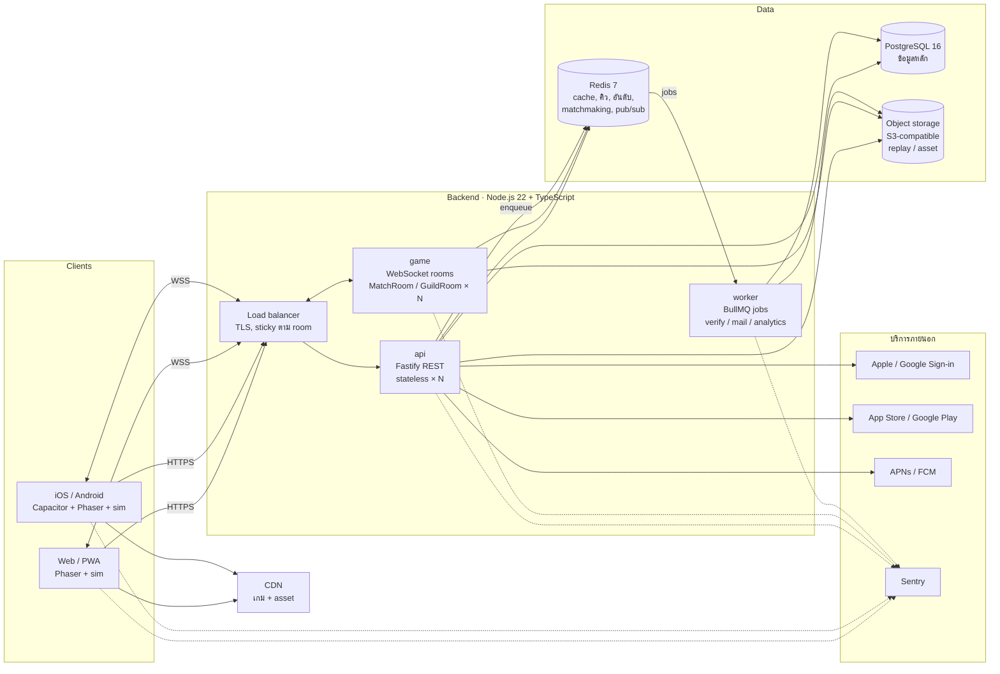
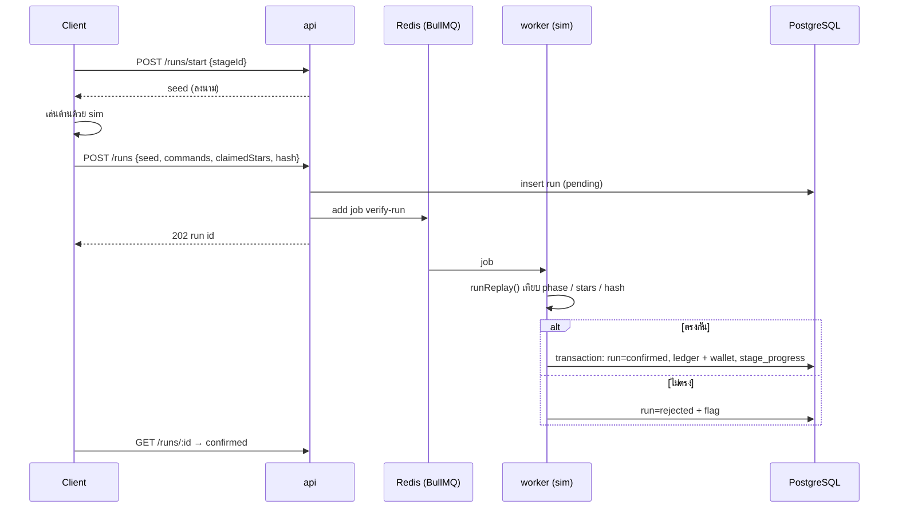
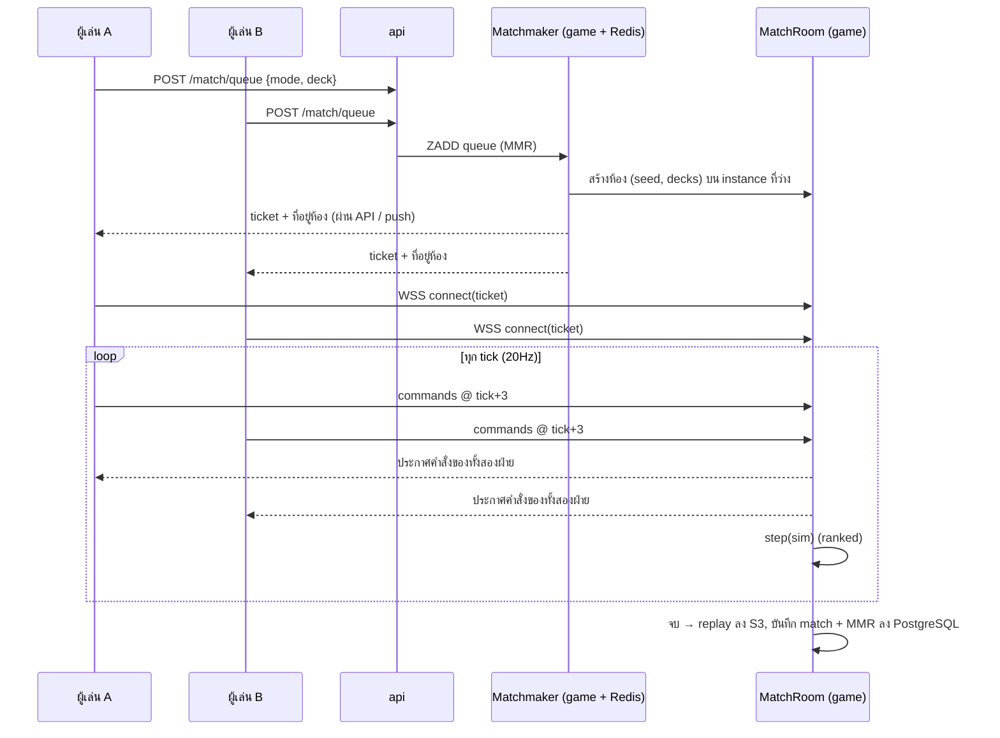

# สถาปัตยกรรมระบบ

> ส่วนหนึ่งของ [GDD](../GDD.md) · การตัดสินใจหลักบันทึกใน [ADR 0003](../adr/0003-node-postgres-backend.md) (แทน ADR 0002)
> สถานะ: ออกแบบแล้ว · ที่สร้างจริงแล้วคือ `packages/sim` และ `packages/client` (M0) · ฝั่งเซิร์ฟเวอร์เริ่มใน M1
> ระดับเป้าหมาย: **ระดับกลาง** รองรับผู้เล่นออนไลน์พร้อมกันหลักหมื่นในภูมิภาคเดียว (SEA) ขยายต่อได้โดยไม่ต้องรื้อ

## 1. หลักการ

1. **กฎเกมมีต้นฉบับที่เดียว:** `packages/sim` (TypeScript, deterministic) เซิร์ฟเวอร์รันเกมซ้ำด้วยตัวนี้ client Unity ใช้พอร์ต C# ที่ต้องผ่าน `npm run sim:parity` ทุก commit ([ADR 0004](../adr/0004-unity-client.md))
2. **เซิร์ฟเวอร์ตัดสินเรื่องที่มีมูลค่า:** เงิน ของ ถ้วย อันดับ การซื้อ client ส่งได้แค่ seed + คำสั่ง ไม่ส่งผลลัพธ์
3. **Stateless API + stateful game server แยกกัน:** API ขยายได้ง่ายแค่เพิ่ม instance ส่วนห้องแข่งอยู่ในหน่วยความจำของ game server
4. **ทุกอย่างเป็น container:** รันบนเครื่องตัวเองด้วย Docker Compose เหมือน production ย้ายผู้ให้บริการ cloud ได้
5. **ข้อมูลเกมเป็น data:** `docs/data/*.json` ถูก bundle กับ client และเผยแพร่เป็น remote config

## 2. ภาพรวม



## 3. โครงสร้าง repo

```
packages/
  sim/        กฎเกม deterministic (มีแล้ว) ── ใช้ทั้ง client, game, worker
  client/     Phaser 3 + Vite: ต้นแบบอ้างอิง/ชุดทดสอบ (client จริงคือ Unity 6 ตาม ADR 0004: prototypes/unity → unity/)
  protocol/   type ของ API / ข้อความ WebSocket + zod schema ตรวจ input (ใช้ร่วม client/server)
  db/         schema + migrations (Drizzle ORM) และ query ที่ใช้ร่วม
  api/        Fastify REST service
  game/       WebSocket game server (rooms, lockstep, matchmaking worker loop)
  worker/     BullMQ job processors (ตรวจรีเพลย์ด้วย sim, ส่งจดหมาย/push, analytics)
  admin/      เว็บเครื่องมือแอดมิน (M4)
infra/
  docker-compose.yml   postgres, redis, minio (S3 จำลอง), api, game, worker
  docker/              Dockerfile ต่อ service (multi-stage, node:22-slim)
docs/data/             ข้อมูลเกม → bundle เข้า client และ publish เป็น remote config
```

เหตุผลที่แยก `api` / `game` / `worker` เป็นสาม process: ภาระงานต่างกันมาก (request สั้น / การเชื่อมต่อค้างนาน / CPU หนักจากการรัน sim) ขยายแยกกันได้ และถ้า worker ทำงานหนัก จะไม่ทำให้ห้องแข่งกระตุก

## 4. หน้าบ้าน (client)

| ชั้น | หน้าที่ | เทคโนโลยี |
|---|---|---|
| Scenes | เมนู, ด่าน, บุกค่าย, ลานสำนัก, ร้านค้า, ชุมนุม | Phaser 3 (มีแล้ว 3 scene) |
| Game loop | รัน `sim` 20Hz, interpolate, บันทึก replay | มีแล้วใน `DefendScene` |
| Net | REST client (แนบ token, refresh อัตโนมัติ, retry) และ WebSocket (ต่อใหม่อัตโนมัติ) | `fetch` + `WebSocket` + type จาก `protocol` |
| State | profile, wallet, progress cache ใน IndexedDB; outbox ของผลด่านที่ยังไม่ส่ง | เล่นเนื้อเรื่องออฟไลน์ได้ |
| Config | ข้อมูลเกมที่ bundle มา + เวอร์ชันใหม่จาก `/config` | ตรวจ hash ก่อนใช้ |
| Native | IAP, push, haptics, secure storage | Capacitor plugins |

client ไม่เก็บค่าเงินที่เชื่อถือได้ ค่าที่แท้จริงอยู่ที่เซิร์ฟเวอร์เสมอ

## 5. หลังบ้าน (Node.js 22 + TypeScript)

### 5.1 `api` (stateless REST)
- **Framework:** [Fastify](https://fastify.dev) เพราะเร็ว มีระบบ plugin และ schema validation ในตัว ใช้คู่กับ zod schema จาก `protocol`
- **DB access:** [Drizzle ORM](https://orm.drizzle.team) ได้ SQL ที่ type-safe และมี migration
- **ขยาย:** เพิ่ม instance หลัง load balancer ไม่มีสถานะในหน่วยความจำ

| กลุ่ม | Endpoint ตัวอย่าง |
|---|---|
| Auth | `POST /auth/guest`, `/auth/apple`, `/auth/google`, `/auth/refresh`, `/auth/logout`, `DELETE /me` |
| Profile / Progress | `GET /me`, `POST /runs/start` (ขอ seed), `POST /runs` (ส่ง replay), `GET /runs/:id` |
| Economy | `GET /wallet`, `POST /buildings/:id/upgrade`, `POST /idle/claim` |
| Gacha / Shop / IAP | `POST /gacha/:banner/pull`, `GET /shop`, `POST /iap/verify`, `POST /iap/notify/{apple,google}` |
| Raid | `GET /raid/opponents`, `PUT /courtyard/layout`, `POST /raid/:id/result` |
| PvP | `POST /match/queue` → ticket + ที่อยู่ game server |
| Guild | `POST /guilds`, `POST /guilds/:id/join`, `GET /guilds/:id` |
| Live ops | `GET /config`, `GET /events`, `GET /mail` |
| Admin | `/admin/*` (role + IP allowlist / SSO) |

**กัน race ของเงิน:** การเปลี่ยนเงิน/ของทุกครั้งทำใน transaction ของ PostgreSQL บนตาราง `wallets` ด้วย `SELECT … FOR UPDATE` และมี `idempotency_key` ต่อคำขอ กดซื้อซ้ำสองครั้งพร้อมกันจึงไม่ได้ของสองครั้ง

### 5.2 `game` (stateful WebSocket)
- **WebSocket:** `ws` (หรือ `uWebSockets.js` ถ้าต้องการรีดประสิทธิภาพ) บน Node
- **MatchRoom:** ห้องอยู่ในหน่วยความจำของ instance เดียว รับคำสั่ง ประกาศคำสั่งทุก tick (20Hz) รัน `sim` คู่ขนานใน ranked และเก็บ replay ลง object storage
- **การหาห้อง:** registry ใน Redis (`room:{id} → instance`) load balancer ส่ง WebSocket ไปถูกเครื่องด้วย sticky routing ตาม room id
- **Matchmaker:** loop ใน `game` อ่านคิวจาก Redis sorted set (คะแนน = MMR) ขยายช่วง MMR ตามเวลารอ ใส่ bot หลัง 45 วิ ใช้ Redis lock ให้มีตัวจับคู่ทำงานทีละตัวต่อโหมด
- **GuildRoom:** แชทชุมนุม ใช้ Redis pub/sub กระจายข้อความข้าม instance

### 5.3 `worker` (งานเบื้องหลัง)
- **คิว:** [BullMQ](https://docs.bullmq.io) บน Redis (retry, delay, priority, dashboard)
- **งาน:**
  - `verify-run` รัน `sim` ตรวจรีเพลย์ แล้วให้รางวัล
  - `verify-raid` ตรวจผลตีสำนัก
  - `mail` / `push` ส่งจดหมายในเกมและ push notification
  - `analytics` รวม event เป็น batch
  - `season-rollover` ปิด season และแจกรางวัล
- รัน sim ใน `worker_threads` ใช้ CPU ได้หลาย core

## 6. ฐานข้อมูล

### 6.1 อะไรเก็บที่ไหน
| ข้อมูล | ที่เก็บ | เหตุผล |
|---|---|---|
| บัญชี, identity, refresh token, progress, วีรชน, wallet, ประวัติธุรกรรม, การซื้อ, ลานสำนัก, raid, แมตช์, MMR, ชุมนุม, จดหมาย, รายงาน/แบน | **PostgreSQL** | ข้อมูลหลัก ต้องถูกต้อง มี transaction และ join |
| session ชั่วคราว, rate limit, คิวจับคู่, room registry, leaderboard รายสัปดาห์, คิวงาน, pub/sub แชท | **Redis** | เร็ว ข้อมูลชั่วคราวหรือคำนวณใหม่ได้ |
| รีเพลย์, asset บทถัดไป, คลิปแชร์ | **Object storage (S3-compatible)** | ไฟล์ใหญ่ ราคาถูก |
| event analytics | worker → คลังข้อมูล (BigQuery หรือ ClickHouse) | ปริมาณมาก ไม่ควรอยู่ใน DB หลัก |

### 6.2 ตารางหลักใน PostgreSQL (ร่าง)

```mermaid
erDiagram
  players ||--o{ identities : has
  players ||--o{ refresh_tokens : has
  players ||--|| wallets : owns
  players ||--o{ wallet_ledger : records
  players ||--o{ stage_progress : has
  players ||--o{ heroes_owned : has
  players ||--o{ purchases : makes
  players ||--o| courtyards : owns
  players ||--o{ runs : submits
  players ||--o{ raids : attacks
  players ||--o{ ratings : has
  players }o--o| guild_members : joins
  guilds ||--o{ guild_members : has
  matches ||--o{ match_players : has
  players ||--o{ match_players : plays
  seasons ||--o{ ratings : scopes

  players { uuid id PK; text display_name; text locale; timestamptz created_at; timestamptz deleted_at; timestamptz banned_until }
  identities { text provider; text subject; uuid player_id FK }
  refresh_tokens { bytea hash PK; uuid player_id FK; uuid family; timestamptz expires_at; bool revoked }
  wallets { uuid player_id PK; bigint silver; bigint jade; bigint qi; int pity_legendary; int version }
  wallet_ledger { bigserial id PK; uuid player_id FK; text currency; bigint delta; text reason; text idempotency_key; timestamptz at }
  stage_progress { uuid player_id FK; text stage_id; smallint stars_mask; int best_ticks }
  heroes_owned { uuid player_id FK; text hero_id; text skin_id; timestamptz obtained_at }
  purchases { text tx_id PK; uuid player_id FK; text platform; text product_id; text status; timestamptz at }
  courtyards { uuid player_id PK; jsonb layout; int version; timestamptz shield_until }
  runs { uuid id PK; uuid player_id FK; text stage_id; bigint seed; text replay_key; text status }
  raids { uuid id PK; uuid attacker_id; uuid defender_id; smallint stars; text replay_key; timestamptz at }
  matches { uuid id PK; text mode; text season_id; text replay_key; timestamptz at }
  match_players { uuid match_id FK; uuid player_id FK; smallint result; real mmr_delta }
  ratings { uuid player_id FK; text season_id FK; text mode; real mmr; real rd; real vol }
  seasons { text id PK; timestamptz starts_at; timestamptz ends_at }
  guilds { uuid id PK; text name; uuid owner_id; timestamptz created_at }
  guild_members { uuid guild_id FK; uuid player_id FK; text role }
```

- **`wallet_ledger`** บันทึกทุกการเปลี่ยนแปลงเงินพร้อมเหตุผล ใช้ตรวจย้อนหลัง ชดเชย และหาการโกง ค่าใน `wallets` คือยอดรวมที่ต้องตรงกับผลรวมของ ledger
- **Migrations:** Drizzle Kit (`packages/db/migrations`) รันใน CI ก่อน deploy
- **Index สำคัญ:** `identities(provider, subject)` unique, `ratings(season_id, mode, mmr)`, `runs(player_id, status)`, `wallet_ledger(player_id, at)`, `raids(defender_id, at)`
- **ขยายตัว:** read replica สำหรับ leaderboard และ analytics, ใช้ PgBouncer จัดการ connection, แบ่ง `wallet_ledger`/`raids`/`runs` เป็น partition รายเดือน ระดับกลางยังไม่ต้อง shard

## 7. ระบบยืนยันตัวตน (Auth)

| ขั้น | วิธี |
|---|---|
| เข้าเล่นครั้งแรก | `POST /auth/guest` สร้าง player + identity แบบ guest |
| ผูกบัญชี | Sign in with Apple (บังคับบน iOS ถ้ามี social login อื่น), Google, อีเมล magic link · เซิร์ฟเวอร์ตรวจ `id_token` กับ public key ของผู้ให้บริการ |
| Access token | JWT อายุ 15 นาที (ES256) ตรวจได้ใน `api` และ `game` โดยไม่ต้องอ่าน DB |
| Refresh token | ค่าสุ่ม 256 บิต เก็บเป็น hash ใน `refresh_tokens` หมุนทุกครั้งที่ใช้ ถ้ามีการใช้ token เก่าซ้ำ ระบบเพิกถอนทั้ง family |
| WebSocket | ticket อายุ 30 วิ เก็บใน Redis ใช้ได้ครั้งเดียว |
| แอดมิน | SSO ของทีม + role + IP allowlist |
| ลบบัญชี | `DELETE /me` ลบข้อมูลส่วนตัว เก็บไว้เฉพาะบันทึกการซื้อที่กฎหมายกำหนด |

ไลบรารี: `jose` (JWT/JWK), `@fastify/rate-limit` (rate limit บน Redis) Auth แยกอยู่ใน module `auth` เดียว ถ้าภายหลังต้องการใช้บริการภายนอกก็เปลี่ยนได้

## 8. Flow สำคัญ

### 8.1 จบด่านแล้วได้รางวัล



### 8.2 PvP บุก–ตั้งรับ real-time



- **Input delay 3 tick (150 ms):** ทั้งสองเครื่องทำคำสั่งพร้อมกันได้แม้ ping ต่างกัน
- **หลุดการเชื่อมต่อ:** กลับเข้ามาได้ภายใน 30 วิ แล้วได้ snapshot ล่าสุด
- **Ranked:** ผลที่นับคือผลจาก sim บนเซิร์ฟเวอร์

### 8.3 ซื้อของ (IAP)
- ตรวจใบเสร็จที่ `api` กับ App Store Server API / Google Play Developer API
- ให้ของครั้งเดียวต่อ `tx_id`: `purchases.tx_id` เป็น primary key และอยู่ใน transaction เดียวกับ ledger
- รับ server notification (refund / ต่ออายุ) แล้วปรับ wallet ผ่าน ledger

## 9. ความปลอดภัยและกันโกง

| ภัย | การป้องกัน |
|---|---|
| แก้ค่าเงินในเครื่อง | เงินจริงอยู่ใน PostgreSQL เท่านั้น |
| ส่งผลด่านปลอม | ส่งเฉพาะ replay, worker รัน sim ซ้ำ, seed ลงนามโดยเซิร์ฟเวอร์ |
| คำสั่งผิดรูปแบบ | `validCommand()` ใน sim (มีแล้ว) + zod ที่ขอบ API/WebSocket |
| PvP desync / โกง | sim บนเซิร์ฟเวอร์ตัดสิน, hash ทุก 5 วิ |
| ซื้อปลอม / refund | ตรวจที่เซิร์ฟเวอร์ + server notifications + ledger |
| กดซ้ำ / race | transaction + `FOR UPDATE` + idempotency key |
| ยิง API ถี่ / บอทสมัคร | rate limit บน Redis + CAPTCHA ตอนสร้าง guest จำนวนมาก |
| SQL injection | query ผ่าน Drizzle (parameterized) เท่านั้น |
| ขโมย token | access สั้น + refresh rotation + ตรวจใช้ซ้ำ |
| Secret | เก็บใน secret manager ของผู้ให้บริการ ไม่อยู่ใน repo หรือ client |
| ข้อมูลส่วนบุคคล | เก็บน้อยที่สุด, ลบได้, PDPA/GDPR |

## 10. สภาพแวดล้อมและการ deploy

| สภาพแวดล้อม | ใช้ทำอะไร | วิธีรัน |
|---|---|---|
| local | พัฒนา, ทดสอบหลายคนบนเครื่องเดียว | `docker compose up` (postgres, redis, minio) + `npm run dev:server` |
| staging | playtest, ทดสอบก่อนปล่อย | container เดียวกับ production ขนาดเล็ก |
| production | ผู้เล่นจริง | ภูมิภาค Singapore (ใกล้ไทย/SEA) |

**ทางเลือกการโฮสต์ระดับกลาง** (ทุกทางใช้ Docker image ชุดเดียวกัน ย้ายภายหลังได้):

| ทางเลือก | เหมาะเมื่อ | หมายเหตุ |
|---|---|---|
| **Managed containers** (เช่น Fly.io, Railway, Render, Google Cloud Run สำหรับ api) + managed PostgreSQL + managed Redis | ทีมเล็ก ไม่มีคนดูแล ops | เริ่มเร็วที่สุด · game server ต้องรองรับ WebSocket ที่ค้างนาน |
| **AWS ap-southeast-1** (ECS Fargate + RDS PostgreSQL + ElastiCache Redis + S3) | ต้องการความมั่นคงระดับองค์กร | ค่าใช้จ่ายและความซับซ้อนสูงกว่า |
| **VPS** (เช่น DigitalOcean SGP) + Docker Compose | งบน้อยมาก ช่วง playtest | ต้องดูแล backup และอัปเดตเอง |

PostgreSQL แบบ managed ใช้ได้หลายเจ้า (RDS, Cloud SQL, Neon, Supabase) Supabase มี MCP เชื่อมกับ session นี้ไว้แล้ว ตัดสินใจเรื่องโฮสต์ก่อนเริ่ม M1 deploy staging

**CDN ของตัวเกม:** ใช้ Cloudflare (หรือ CDN ของผู้ให้บริการที่เลือก) เสิร์ฟไฟล์ static ของ client

**CI (GitHub Actions):** typecheck → test (รวม determinism + balance) → build client + Docker images → smoke (Playwright) → migrate DB → deploy staging อัตโนมัติ → production เมื่อกดอนุมัติ

**Version gate:** client ส่ง sim version มากับทุกคำขอ ถ้าไม่ตรงกับเซิร์ฟเวอร์จะถูกบังคับอัปเดตก่อนเข้า PvP

## 11. การมอนิเตอร์
- **Sentry:** error ทั้ง client และทุก service
- **Metrics:** OpenTelemetry → Prometheus/Grafana (หรือเครื่องมือของผู้ให้บริการ) เก็บ latency, error rate, จำนวนห้อง, จำนวน connection, ความยาวคิว BullMQ
- **Dashboard เกม:** DAU, retention, ARPDAU, win-rate ต่อสำนัก, เวลาจับคู่, อัตรา desync
- **Alert:**
  - desync เกิน 0.5% ของแมตช์
  - เวลาจับคู่ p90 เกิน 60 วิ
  - คิว verify ค้างเกิน 2 นาที
  - ตรวจ IAP ล้มเหลว
- **Backup:** point-in-time recovery ของ PostgreSQL, ทดสอบกู้คืนเดือนละครั้ง

## 12. ขนาดและต้นทุน (ประมาณการ ต้องวัดจริง)
- **เริ่มต้น / staging:** api ×1, game ×1, worker ×1, PostgreSQL ขนาดเล็ก, Redis ขนาดเล็ก
- **Soft launch:** api ×2, game ×2, worker ×2 (เพิ่มตามความยาวคิว), PostgreSQL + read replica 1 ตัว
- **ตัวแปรต้นทุนหลัก:**
  - CPU ที่ใช้รัน sim ซ้ำ ต้องวัดใน M1 ถ้าสูงเกินจะเปลี่ยนเป็นตรวจทุกครั้งเฉพาะ ranked/leaderboard และสุ่มตรวจด่านทั่วไป
  - จำนวนห้องแข่งต่อ instance ของ game server

## 13. ลำดับการสร้างตาม milestone

| Milestone | สิ่งที่สร้าง |
|---|---|
| M1 Online core | `infra/docker-compose.yml`, `packages/{protocol,db,api,game,worker}` โครงพื้นฐาน, guest auth + refresh rotation, `/me`, cloud save, `/runs` + verify-run, ห้อง co-op lockstep, migrations, CI deploy staging |
| M2 Competitive | Matchmaker, ranked ใน MatchRoom, ratings/seasons, replay ลง S3, ดูเพื่อนเล่นสด |
| M2b Meta + Raid | wallet + ledger, อาคาร/idle claim, ลานสำนัก + raid + โล่ |
| M4 Monetization / Live ops | IAP verify + notifications, gacha ฝั่งเซิร์ฟเวอร์, shop, mail/push, remote config, admin, Apple/Google sign-in |
| ก่อนเปิดตัว | rate limit + CAPTCHA, ลบบัญชี, privacy, load test (k6) ของ game server และ matchmaker, ทดสอบกู้คืน backup |
