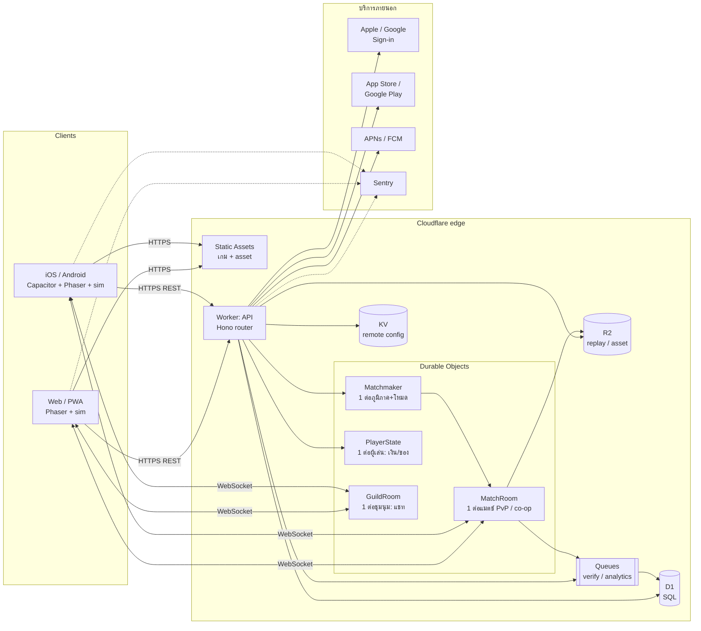
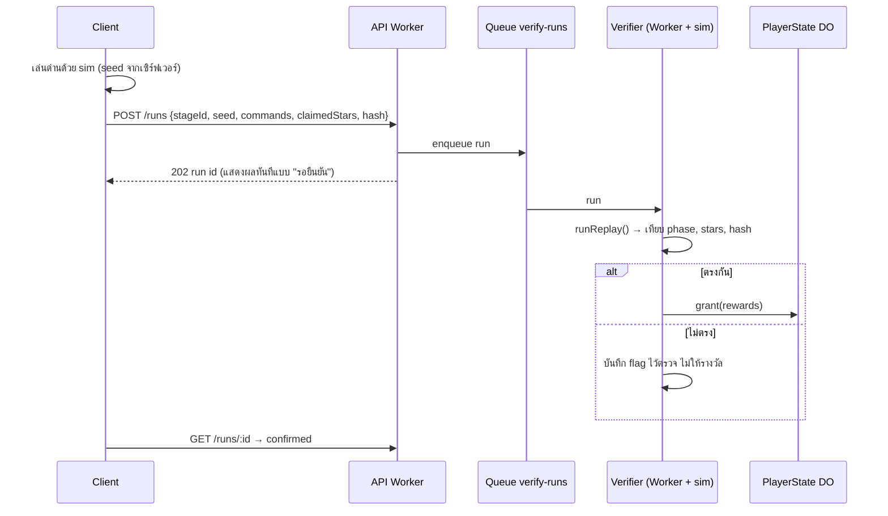
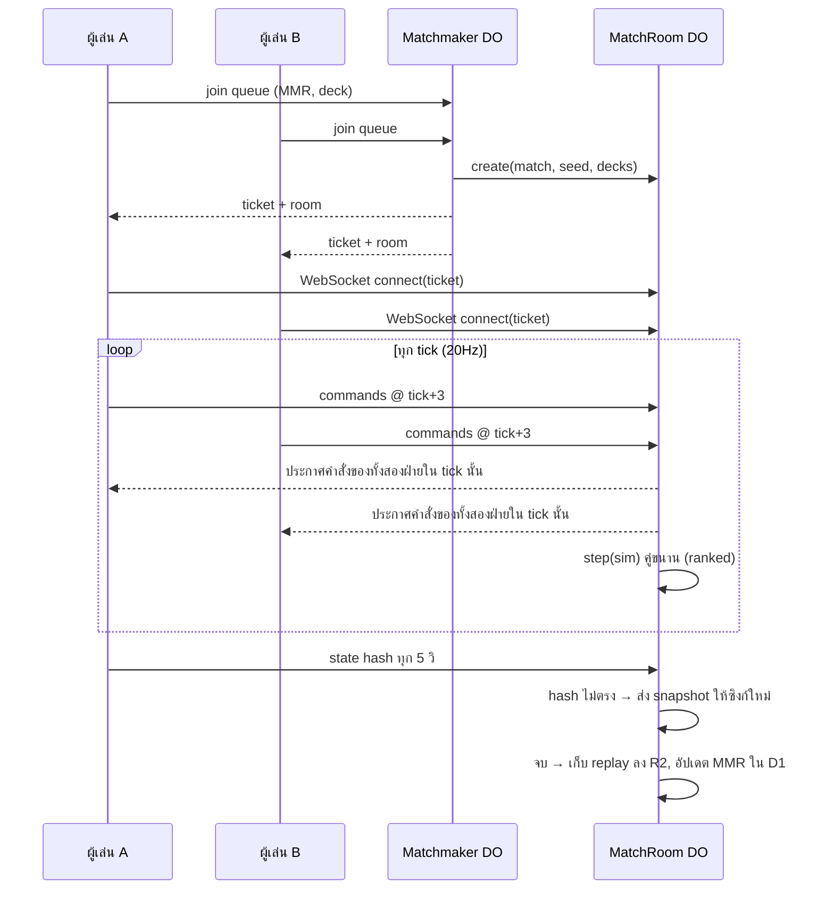
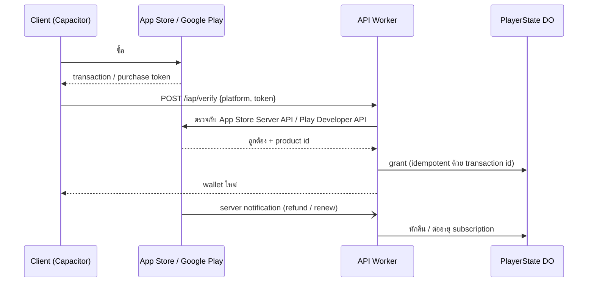

# สถาปัตยกรรมระบบ

> ส่วนหนึ่งของ [GDD](../GDD.md) · การตัดสินใจหลักบันทึกใน [ADR 0002](../adr/0002-platform-architecture.md)
> สถานะ: ออกแบบแล้ว · ที่สร้างจริงแล้วคือ `packages/sim` และ `packages/client` (M0) · ฝั่งเซิร์ฟเวอร์เริ่มใน M1

## 1. หลักการ 5 ข้อ

1. **กฎเกมมีที่เดียว:** `packages/sim` (TypeScript ล้วน, deterministic) ใช้ร่วมกันทั้งเครื่องผู้เล่นและเซิร์ฟเวอร์ เซิร์ฟเวอร์จึงรันเกมซ้ำเพื่อตรวจผลได้ ทำให้ไม่ต้องเขียนกฎสองชุด
2. **เซิร์ฟเวอร์เป็นผู้ตัดสินเรื่องที่มีมูลค่า:** สกุลเงิน ของ ถ้วย อันดับ และผลการซื้อ client ส่งได้แค่ "คำสั่ง" (seed + commands) ไม่ส่ง "ผลลัพธ์"
3. **Edge-first บน Cloudflare:** โค้ดรันใกล้ผู้เล่น (สำคัญกับ SEA) ไม่มีเซิร์ฟเวอร์ให้ดูแล และเริ่มได้ฟรี
4. **เล่นออฟไลน์ได้:** เนื้อเรื่องเล่นได้โดยไม่มีเน็ต แล้วซิงก์ผลทีหลัง ส่วน PvP/co-op ต้องออนไลน์
5. **ข้อมูลเกมเป็น data ไม่ใช่ code:** `docs/data/*.json` ถูก bundle ไปกับ client และเผยแพร่ผ่าน remote config ปรับสมดุลได้โดยไม่ต้องอัปเดตแอป

## 2. ภาพรวม



## 3. โครงสร้าง repo (monorepo)

```
packages/
  sim/        กฎเกม deterministic (มีแล้ว) ── ใช้ทั้ง client และ server
  client/     หน้าบ้าน Phaser 3 + Vite (มีแล้ว) → build เป็นเว็บ และห่อด้วย Capacitor
  protocol/   type ของ API และข้อความ WebSocket + zod schema สำหรับตรวจ input (M1)
  server/     Worker + Durable Objects + migrations ของ D1 (M1)
  admin/      หน้าเครื่องมือแอดมิน (M4) ใช้ Worker เดียวกัน แต่ route แยก
docs/data/    ข้อมูลเกม → bundle เข้า client และ publish ขึ้น KV
```

`sim` ห้ามพึ่ง DOM หรือ Node API เพื่อให้รันได้ทั้งเบราว์เซอร์, Worker และ Durable Object

## 4. หน้าบ้าน (client)

| ชั้น | หน้าที่ | เทคโนโลยี |
|---|---|---|
| Scenes | เมนู, ด่าน, บุกค่าย, ลานสำนัก, ร้านค้า, ชุมนุม | Phaser 3 scenes (มีแล้ว 3 scene) |
| Game loop | รัน `sim` ที่ 20Hz, ประมาณตำแหน่งระหว่าง tick, บันทึก replay | มีแล้วใน `DefendScene` |
| Net | REST client (เติม token ให้อัตโนมัติ, retry), WebSocket (ต่อใหม่อัตโนมัติ) | `fetch` + `WebSocket` ล้วน |
| State | profile, กระเป๋าเงิน, progress → cache ใน IndexedDB, ซิงก์เมื่อออนไลน์ | outbox pattern: เก็บผลด่านที่ยังไม่ส่งไว้ในคิว |
| Config | ข้อมูลเกมฉบับที่ bundle มา + ฉบับใหม่จาก `/config` ถ้า version ใหม่กว่า | ตรวจ hash ก่อนใช้ |
| Native | IAP, push, haptics, secure storage ของ refresh token | Capacitor plugins |
| i18n | ข้อความ TH/EN แยกไฟล์ | JSON ต่อภาษา |

**ข้อมูลที่ client เก็บ:** refresh token (Keychain/Keystore บนมือถือ หรือ IndexedDB บนเว็บ), cache profile และคิวผลด่านที่ยังไม่ซิงก์ **ไม่เก็บ** ค่าเงินที่เชื่อถือได้ ค่าที่จริงอยู่ที่เซิร์ฟเวอร์เสมอ

## 5. หลังบ้าน (server)

### 5.1 Worker: API (stateless)
ใช้ [Hono](https://hono.dev) เป็น router (เล็ก เร็ว ออกแบบมาสำหรับ Workers) ทุก route ตรวจ input ด้วย schema จาก `packages/protocol`

| กลุ่ม | Endpoint ตัวอย่าง | หมายเหตุ |
|---|---|---|
| Auth | `POST /auth/guest`, `POST /auth/apple`, `POST /auth/google`, `POST /auth/refresh`, `POST /auth/logout`, `DELETE /me` | ดู §7 |
| Profile | `GET /me`, `PATCH /me` (ชื่อ, ภาษา) | |
| Progress | `POST /runs` (ส่ง replay ของด่าน) → `202` + run id · `GET /runs/:id` | ตรวจผลผ่าน Queue ดู §6.1 |
| Economy | `GET /wallet`, `POST /buildings/:id/upgrade`, `POST /idle/claim` | ผ่าน `PlayerState` DO เท่านั้น |
| Gacha/Shop | `POST /gacha/:banner/pull`, `GET /shop`, `POST /iap/verify` | สุ่มฝั่งเซิร์ฟเวอร์, บันทึก pity |
| Raid | `GET /raid/opponents`, `PUT /courtyard/layout`, `POST /raid/:id/result` | ตรวจผลด้วย sim |
| PvP | `POST /match/queue` → ได้ ticket สำหรับ WebSocket | |
| Guild | `POST /guilds`, `POST /guilds/:id/join`, `GET /guilds/:id` | แชทใช้ WebSocket ของ `GuildRoom` |
| Live ops | `GET /config` (version + hash), `GET /events`, `GET /mail` | |
| Admin | `/admin/*` | Cloudflare Access + role |

### 5.2 Durable Objects (stateful, 1 อินสแตนซ์ต่อ key)

| DO | Key | ทำอะไร | ทำไมใช้ DO |
|---|---|---|---|
| `PlayerState` | player id | เงิน, ของ, pity, คิว idle ทุกการเปลี่ยนแปลงทำทีละรายการ | ป้องกันการกดซ้ำ/race (เช่น ซื้อสองครั้งพร้อมกัน) โดยไม่ต้องใช้ lock ใน DB |
| `Matchmaker` | ภูมิภาค + โหมด | คิวจับคู่ตาม MMR ขยายช่วงตามเวลารอ, ใส่ bot หลัง 45 วิ | ต้องมีที่เดียวที่เห็นคิวทั้งหมด |
| `MatchRoom` | match id | lockstep relay, ตรวจ hash, ต่อใหม่, รัน sim คู่ขนานใน ranked, เก็บ replay ลง R2 | สถานะของแมตช์อยู่ในหน่วยความจำ ใกล้ผู้เล่น |
| `GuildRoom` | guild id | แชท, กรองคำ, ข้อความล่าสุด 200 ข้อความ | WebSocket ต่อชุมนุม |

WebSocket ทั้งหมดใช้ **Hibernation API** ของ DO: เวลาห้องเงียบจะไม่ถูกคิดเงินค่าหน่วยความจำ

### 5.3 Queues (งานเบื้องหลัง)
- `verify-runs`: รัน sim ตรวจผลด่าน/raid แล้วให้รางวัล
- `analytics`: รวม event ส่งเข้าคลังข้อมูลเป็น batch
- `mail-push`: ส่งจดหมายในเกมและ push notification

## 6. Flow สำคัญ

### 6.1 จบด่านแล้วได้รางวัล (กันโกง)



seed ของด่านออกโดยเซิร์ฟเวอร์ (`POST /runs/start`) จึงเลือก seed ที่ดีเองไม่ได้ ถ้าเล่นออฟไลน์ client สร้าง seed เองได้ แต่ด่านนั้นจะไม่นับ leaderboard

### 6.2 PvP บุก–ตั้งรับ real-time



- **Input delay 3 tick (150 ms):** คำสั่งนัดทำใน tick ข้างหน้า ทั้งสองเครื่องจึงทำพร้อมกันได้แม้ ping ต่างกัน
- **หลุดการเชื่อมต่อ:** มีเวลากลับมา 30 วิ ระหว่างนั้นเกมเดินต่อโดยไม่มีคำสั่งจากฝั่งที่หลุด กลับมาแล้วได้ snapshot ล่าสุด
- **Ranked:** ผลที่นับคือผลจาก sim ใน DO ไม่ใช่ผลที่ client ส่งมา

### 6.3 ซื้อของ (IAP)



## 7. ระบบยืนยันตัวตน (Auth)

**เป้าหมาย:** เข้าเล่นได้ทันทีโดยไม่ต้องสมัคร แล้วผูกบัญชีภายหลังเพื่อย้ายเครื่อง/กู้บัญชี

| ขั้น | วิธี |
|---|---|
| เข้าเล่นครั้งแรก | `POST /auth/guest` → สร้าง player + guest identity คืน access + refresh token |
| ผูกบัญชี | Sign in with Apple (บังคับบน iOS ถ้ามี social login อื่น), Google, อีเมล magic link · เซิร์ฟเวอร์ตรวจ `id_token` กับ public key ของผู้ให้บริการ |
| Access token | JWT อายุ 15 นาที ลงนามด้วย key ใน Workers Secrets ตรวจได้ในทุก Worker/DO โดยไม่ต้องอ่าน DB |
| Refresh token | ค่าสุ่มยาว เก็บแบบ hash ใน D1 หมุนใหม่ทุกครั้งที่ใช้ (rotation) ถ้าใช้ตัวเก่าซ้ำ → เพิกถอนทั้งชุด (กันขโมย token) |
| WebSocket | ใช้ ticket อายุ 30 วิ ที่ได้จาก REST (ไม่ใส่ token ใน URL ระยะยาว) |
| แอดมิน | Cloudflare Access (SSO ของทีม) + role ใน D1 |
| ลบบัญชี | `DELETE /me` → ลบข้อมูลส่วนตัว เก็บเฉพาะบันทึกการซื้อตามที่กฎหมายกำหนด |

**ทำไมทำเองแทนการใช้บริการสำเร็จรูป:** เกมต้องมี guest account และ token ที่ตรวจได้ทั้งใน Worker และ DO แบบไม่มี latency เพิ่ม ส่วนที่ทำเองจึงเล็ก คือการตรวจ `id_token` + JWT + refresh rotation ใช้ไลบรารี `jose` ถ้าภายหลังต้องการลดภาระ ระบบนี้ย้ายไปบริการภายนอกได้เพราะแยกอยู่ใน `/auth` เท่านั้น

## 8. ฐานข้อมูล

### 8.1 อะไรเก็บที่ไหน
| ข้อมูล | ที่เก็บ | เหตุผล |
|---|---|---|
| บัญชี, identity, refresh token, progress, ลีก/MMR, ชุมนุม, การซื้อ, รายงาน/แบน | **D1** (SQL) | ต้อง query/join, ข้อมูลถาวร |
| เงิน/ของ/pity ที่เปลี่ยนบ่อย | **PlayerState DO storage** + เขียนสำเนาลง D1 เป็นระยะ | เขียนเร็ว ทีละรายการ ไม่ชนกัน |
| สถานะแมตช์ระหว่างเล่น | หน่วยความจำของ **MatchRoom DO** | ชั่วคราว |
| ข้อมูลเกม/สมดุล, ธงฟีเจอร์, อีเวนต์ | **KV** | อ่านเยอะ เขียนน้อย กระจายทั่วโลก |
| รีเพลย์, asset บทถัดไป, คลิปแชร์ | **R2** | ไฟล์ใหญ่ ไม่มีค่า egress |
| event analytics | Queue → คลังข้อมูล (Analytics Engine หรือ BigQuery) | ปริมาณมาก ไม่ควรอยู่ใน DB หลัก |

### 8.2 ตารางหลักใน D1 (ร่าง)

```mermaid
erDiagram
  players ||--o{ identities : has
  players ||--o{ refresh_tokens : has
  players ||--o{ stage_progress : has
  players ||--o{ heroes_owned : has
  players ||--o{ purchases : makes
  players ||--o| courtyards : owns
  players ||--o{ ratings : has
  players }o--o| guild_members : joins
  guilds ||--o{ guild_members : has
  players ||--o{ runs : submits
  players ||--o{ raids : attacks
  matches ||--o{ match_players : has
  players ||--o{ match_players : plays
  seasons ||--o{ ratings : scopes

  players { text id PK; text display_name; text locale; int created_at; int deleted_at; int banned_until }
  identities { text provider; text subject; text player_id FK }
  refresh_tokens { text hash PK; text player_id FK; text family; int expires_at; int revoked }
  stage_progress { text player_id FK; text stage_id; int stars_mask; int best_ticks }
  heroes_owned { text player_id FK; text hero_id; text skin_id; int obtained_at }
  purchases { text tx_id PK; text player_id FK; text platform; text product_id; text status; int at }
  courtyards { text player_id PK; text layout_json; int version; int shield_until }
  runs { text id PK; text player_id FK; text stage_id; int seed; text replay_key; text status }
  raids { text id PK; text attacker_id; text defender_id; int stars; text replay_key; int at }
  matches { text id PK; text mode; text season_id; text replay_key; int at }
  match_players { text match_id FK; text player_id FK; int result; int mmr_delta }
  ratings { text player_id FK; text season_id FK; text mode; real mmr; real rd; real vol }
  seasons { text id PK; int starts_at; int ends_at }
  guilds { text id PK; text name; text owner_id; int created_at }
  guild_members { text guild_id FK; text player_id FK; text role }
```

- **Migrations:** `wrangler d1 migrations` เก็บไฟล์ SQL ใน `packages/server/migrations/` และรันใน CI ก่อน deploy
- **ขยายตัว:** D1 หนึ่งฐานมีขนาดจำกัด (ราว 10GB) เมื่อโตขึ้นจะแยกตามหน้าที่ (account / pvp / guild) และย้ายข้อมูลรายผู้เล่นที่เขียนบ่อยไปอยู่ใน `PlayerState` DO ซึ่งขยายตามจำนวนผู้เล่นได้เอง

## 9. ความปลอดภัยและกันโกง

| ภัย | การป้องกัน |
|---|---|
| แก้ค่าเงินในเครื่อง | เงินจริงอยู่ที่เซิร์ฟเวอร์เท่านั้น ค่าที่ client มีเป็นเพียงสำเนาแสดงผล |
| ส่งผลด่านปลอม | ส่งแค่ replay แล้วเซิร์ฟเวอร์รัน sim ซ้ำ (§6.1) · seed ออกโดยเซิร์ฟเวอร์ |
| คำสั่งผิดรูปแบบ | `validCommand()` ใน sim (มีแล้ว) + zod schema ที่ขอบ API |
| Desync / โกงใน PvP | DO รัน sim เป็นผู้ตัดสิน · hash ทุก 5 วิ |
| ซื้อปลอม / refund แล้วเก็บของ | ตรวจ receipt ที่เซิร์ฟเวอร์ + รับ server notifications |
| ยิง API ถี่ | Rate limiting binding ของ Workers ต่อ player/IP + Turnstile ตอนสร้าง guest จำนวนมาก |
| ขโมย token | access สั้น, refresh rotation + ตรวจการใช้ซ้ำ |
| ข้อมูลส่วนบุคคล | เก็บน้อยที่สุด, ลบได้, PDPA/GDPR (ดู [economy.md](economy.md)) |
| Secret รั่ว | Workers Secrets เท่านั้น ไม่มี secret ใน client หรือ repo |

## 10. สภาพแวดล้อมและการ deploy

| สภาพแวดล้อม | ใช้ทำอะไร | วิธีรัน |
|---|---|---|
| local | พัฒนา, เล่นหลายคนบนเครื่องเดียว | `npm run dev` + `wrangler dev` (จำลอง D1/KV/R2/DO ในเครื่อง) |
| preview | ทุก PR ได้ URL ของตัวเอง | Workers preview deployments |
| staging | ทดสอบก่อนปล่อย, playtest | `wrangler deploy --env staging` |
| production | ผู้เล่นจริง | deploy หลังกดอนุมัติใน GitHub Actions |

**CI (GitHub Actions):** typecheck → test (รวม determinism + balance) → build → smoke (Playwright) → migrate D1 → deploy

**Version gate:** client ส่ง `sim` version มากับทุก request ถ้าไม่ตรงกับเซิร์ฟเวอร์จะถูกบังคับอัปเดตก่อนเข้า PvP เพราะ PvP ต้องใช้กฎเกมชุดเดียวกัน

## 11. การมอนิเตอร์
- **Sentry:** error ทั้ง client, Worker และ DO (มี MCP เชื่อมไว้แล้ว)
- **Workers Logs / Analytics:** latency, error rate ต่อ route
- **Dashboard เกม:** DAU, retention, ARPDAU, win-rate ต่อสำนัก, เวลาจับคู่, อัตรา desync
- **Alert:** desync เกิน 0.5% ของแมตช์, เวลาจับคู่ p90 เกิน 60 วิ, ตรวจ IAP ล้มเหลว

## 12. ค่าใช้จ่าย (ประมาณการคร่าวๆ ต้องวัดจริง)
- **ช่วงพัฒนา:** free tier ของ Workers/D1/KV/R2/DO
- **Soft launch:** Workers Paid เริ่ม $5/เดือน + ค่าใช้ตามจริง
- **ตัวแปรหลักของต้นทุน:** เวลา CPU ที่ใช้รัน sim ซ้ำ (ตรวจด่าน, ranked) ต้องวัดตั้งแต่ M1 ถ้าแพงเกินจะเปลี่ยนเป็นสุ่มตรวจ (เช่น ตรวจ 100% เฉพาะ leaderboard/ranked และสุ่มตรวจด่านทั่วไป)

## 13. ลำดับการสร้างตาม milestone

| Milestone | สิ่งที่สร้างฝั่งเซิร์ฟเวอร์ |
|---|---|
| M1 Online core | `packages/protocol`, `packages/server`: guest auth, `/me`, cloud save + `/runs` (ตรวจด้วย sim), `MatchRoom` สำหรับ co-op lockstep, D1 migrations, CI deploy staging |
| M2 Competitive | `Matchmaker`, ranked ใน `MatchRoom`, `ratings`/`seasons`, replay ใน R2, โหมดผู้ชมเพื่อน |
| M2b Meta + Raid | `PlayerState` DO (เงิน/อาคาร/idle claim), ลานสำนัก + raid + โล่ |
| M4 Monetization/Live ops | IAP verify + notifications, gacha ฝั่งเซิร์ฟเวอร์, shop, mail, remote config ใน KV, admin, Apple/Google sign-in |
| ก่อนเปิดตัว | rate limit, Turnstile, ลบบัญชี, privacy, load test MatchRoom/Matchmaker |
